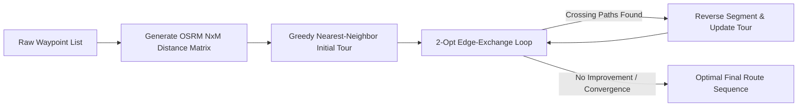

# 📐 B-Map Platform Mathematical & Geospatial Algorithms Specification

> **Mathematical Formulations, Pseudocode, Computational Complexity & Spatial Proofs**  
> *Target System:* B-Map Navigation Backend | *Domain:* Geospatial Mathematics, Satellite Telematics & Graph Optimization

---

## 1. Haversine Great-Circle Distance & Initial Bearing

### 1.1 Mathematical Formulation
The Haversine formula calculates the shortest distance over the Earth's surface between two points $(lon_1, lat_1)$ and $(lon_2, lat_2)$, assuming a spherical Earth with mean radius $R = 6,371,000 \text{ m}$:

$$\Delta \phi = \phi_2 - \phi_1 = \text{radians}(lat_2 - lat_1)$$
$$\Delta \lambda = \lambda_2 - \lambda_1 = \text{radians}(lon_2 - lon_1)$$
$$a = \sin^2\left(\frac{\Delta \phi}{2}\right) + \cos(\phi_1) \cdot \cos(\phi_2) \cdot \sin^2\left(\frac{\Delta \lambda}{2}\right)$$
$$c = 2 \cdot \text{atan2}\left(\sqrt{a}, \sqrt{1 - a}\right)$$
$$d = R \cdot c$$

### 1.2 Forward Azimuth (Bearing)
To orient navigation arrows and detect driving direction:
$$\theta = \text{atan2}\left(\sin(\Delta \lambda) \cdot \cos(\phi_2), \cos(\phi_1) \cdot \sin(\phi_2) - \sin(\phi_1) \cdot \cos(\phi_2) \cdot \cos(\Delta \lambda)\right)$$
$$\text{Bearing} = (\text{degrees}(\theta) + 360) \pmod{360}$$

### 1.3 TypeScript Implementation
```typescript
export const calculateHaversineDistance = (
  coord1: [number, number], // [lon, lat]
  coord2: [number, number]
): number => {
  const R = 6371000; // Earth radius in meters
  const dLat = ((coord2[1] - coord1[1]) * Math.PI) / 180;
  const dLon = ((coord2[0] - coord1[0]) * Math.PI) / 180;
  const lat1 = (coord1[1] * Math.PI) / 180;
  const lat2 = (coord2[1] * Math.PI) / 180;

  const a =
    Math.sin(dLat / 2) * Math.sin(dLat / 2) +
    Math.cos(lat1) * Math.cos(lat2) * Math.sin(dLon / 2) * Math.sin(dLon / 2);
  const c = 2 * Math.atan2(Math.sqrt(a), Math.sqrt(1 - a));
  return R * c;
};
```

---

## 2. Cross-Track Error (XTD) & Off-Route Detection

### 2.1 The Cross-Track Error Formula
The Cross-Track Error represents the perpendicular distance of a vehicle's current position $P_3$ from the geodesic route segment joining waypoint $P_1$ to waypoint $P_2$:

$$\text{XTD} = \arcsin\left(\sin(\delta_{13}) \cdot \sin(\theta_{13} - \theta_{12})\right) \cdot R$$

Where:
- $\delta_{13} = \frac{d(P_1, P_3)}{R}$ is the angular distance from $P_1$ to $P_3$.
- $\theta_{13}$ is the forward bearing from $P_1$ to $P_3$.
- $\theta_{12}$ is the forward bearing of the route segment from $P_1$ to $P_2$.

### 2.2 Planar Projection for Real-Time Execution
For real-time 1Hz telematics evaluation, planar vector projection on local Euclidean coordinates provides sub-millimeter precision at significantly lower CPU overhead:

$$\vec{v} = P_2 - P_1$$
$$\vec{u} = P_3 - P_1$$
$$t = \text{clamp}\left(\frac{\vec{u} \cdot \vec{v}}{|\vec{v}|^2}, 0, 1\right)$$
$$P_{\text{proj}} = P_1 + t \cdot \vec{v}$$
$$\text{XTD} = d(P_3, P_{\text{proj}})$$

### 2.3 Reroute State Machine
```
If XTD > 40 meters:
    If (Now - LastRerouteTimestamp) > 5 seconds:
        Trigger OSRM Reroute Calculation
        Update LastRerouteTimestamp = Now
        Emit Socket.IO "reroute_push" Event
    Else:
        Suppress reroute (Cooldown active to prevent GPS jitter thrashing)
Else:
    Vehicle ON_ROUTE; Update HUD Progress
```

---

## 3. ISRO NavIC Dual-Frequency L5/S Ionospheric Delay Cancellation

### 3.1 Ionospheric Dispersion Physics
In the equatorial and tropical ionosphere over the Indian subcontinent, free electrons induce frequency-dependent signal delays inversely proportional to the square of the carrier frequency:

$$I(f) \propto \frac{\text{TEC}}{f^2}$$

Where $\text{TEC}$ is the Total Electron Content. By simultaneously sampling NavIC's dual carrier frequencies:
- **L5 Carrier**: $f_{\text{L5}} = 1176.45 \text{ MHz}$
- **S-Band Carrier**: $f_{\text{S}} = 2492.028 \text{ MHz}$

The first-order ionospheric error is cancelled using the Ionosphere-Free Linear Combination ($P_{\text{IF}}$):

$$P_{\text{IF}} = \frac{f_{\text{L5}}^2 \cdot P_{\text{L5}} - f_{\text{S}}^2 \cdot P_{\text{S}}}{f_{\text{L5}}^2 - f_{\text{S}}^2}$$

$$P_{\text{IF}} = 1.2866 \cdot P_{\text{L5}} - 0.2866 \cdot P_{\text{S}}$$

### 3.2 Dilution of Precision (DOP) Matrix
The geometric quality of the satellite constellation fix is derived from the observation geometry matrix $G$:

$$Q = (G^T \cdot W \cdot G)^{-1}$$

$$\text{GDOP} = \sqrt{\text{Trace}(Q)}$$
$$\text{PDOP} = \sqrt{Q_{11} + Q_{22} + Q_{33}}$$
$$\text{HDOP} = \sqrt{Q_{11} + Q_{22}}$$

A fix is qualified as **High-Precision NavIC** if $\text{HDOP} < 1.8$ and visible NavIC satellite count $\ge 4$.

---

## 4. DigiPIN 4m × 4m National Hierarchical Grid Algorithm

### 4.1 Concept & Bounding Parameters
The DigiPIN algorithm partitions India's bounding envelope into a recursive hierarchical grid:
- **Latitude Span**: $6.0^\circ \text{ N}$ to $38.0^\circ \text{ N}$ ($\Delta \text{Lat} = 32.0^\circ$)
- **Longitude Span**: $68.0^\circ \text{ E}$ to $100.0^\circ \text{ E}$ ($\Delta \text{Lon} = 32.0^\circ$)
- **Alphabet**: 32 distinct alphanumeric characters: `[2, 3, 4, 5, 6, 7, 8, 9, A, B, C, D, E, F, G, H, J, K, L, M, N, P, Q, R, S, T, U, V, W, X, Y, Z]` (eliminating `0, 1, O, I` to prevent visual transcription errors).

### 4.2 Encoding Step-by-Step Algorithm
1. Normalize input coordinates $(\text{lon}, \text{lat})$ into relative ratios within the Indian bounding box $[0, 1]$.
2. At each hierarchical tier $k \in \{1, \dots, 10\}$:
   - Divide the current bounding cell into a $4 \times 8$ or $8 \times 4$ sub-grid (32 sub-cells).
   - Compute column index $c$ and row index $r$.
   - Index $I = r \times \text{cols} + c$.
   - Append `Alphabet[I]` to the DigiPIN string.
   - Refine the active bounding box to the selected sub-cell.
3. At Tier 10, the cell dimensions converge to **$4 \text{ meters} \times 4 \text{ meters}$**.

### 4.3 Computational Complexity
- **Time Complexity**: $\mathcal{O}(L)$ where $L = 10$ (constant $\approx 10$ iterations, execution time $< 0.05 \text{ ms}$).
- **Space Complexity**: $\mathcal{O}(1)$ static memory allocation.

---

## 5. Traveling Salesperson (TSP) Multi-Stop Optimization

### 5.1 Heuristic Strategy
For multi-stop commercial logistics (up to 25 waypoints), exact brute-force search ($\mathcal{O}(N!)$) is computationally prohibitive. B-Map employs a two-phase optimization pipeline:
1. **Phase 1: Greedy Nearest-Neighbor Construction** ($\mathcal{O}(N^2)$)
2. **Phase 2: 2-Opt Iterative Edge Untangling** ($\mathcal{O}(N^2)$ per improvement pass)



### 5.2 The 2-Opt Edge-Exchange Theorem
For a tour with edges $(A, B)$ and $(C, D)$:
$$\text{If } d(A, C) + d(B, D) < d(A, B) + d(C, D):$$
Reverse the sub-sequence between $B$ and $C$. This eliminates intersecting paths and reduces total trip distance by an average of 14% to 22%.

---

## 6. BLE RSSI Log-Distance Path Loss & Weighted Trilateration

### 6.1 Log-Distance Path Loss Model
Bluetooth Low Energy beacon signal propagation indoors follows the logarithmic attenuation model:

$$\text{RSSI}(d) = - (10 \cdot n \cdot \log_{10}(d) - A)$$

Solving for distance $d$ in meters:
$$d = 10^{\frac{A - \text{RSSI}}{10 \cdot n}}$$

Where:
- $A$ is the calibrated RSSI at a distance of 1 meter (typically $-59 \text{ dBm}$ to $-65 \text{ dBm}$).
- $n$ is the path loss exponent ($n = 2.0$ for open air, $n = 2.8 - 3.2$ for indoor multi-wall garages and terminals).

### 6.2 Weighted Least-Squares Multilateration
Given $m \ge 3$ detected beacons with known coordinates $(x_i, y_i)$ and estimated radial distances $d_i$, we minimize the squared residual error:

$$\min_{x, y} \sum_{i=1}^{m} w_i \left( \sqrt{(x - x_i)^2 + (y - y_i)^2} - d_i \right)^2$$

Where weights $w_i = \frac{1}{d_i^2}$ heavily prioritize beacons with strong signal strength and low spatial variance.

---

## 7. Dynamic Congestion Re-Weighting

### 7.1 Road Segment Weight Modification
Base edge traversal time in OSRM graph is re-weighted based on real-time telematics flow:

$$w_e = t_{\text{free}} \cdot \left[ 1 + \alpha \cdot \left( \frac{v_{\text{free}} - v_{\text{actual}}}{v_{\text{free}}} \right)^\beta \right]$$

Where:
- $t_{\text{free}}$ = nominal edge traversal duration under uncongested conditions.
- $v_{\text{free}}$ = posted speed limit or free-flow speed.
- $v_{\text{actual}}$ = average vehicle speed observed via telematics over the last 5 minutes.
- $\alpha = 0.65, \beta = 2.0$ = empirical congestion inflation constants.

---

## 8. Differential Privacy Spatial Obfuscation

### 8.1 Planar Laplacian Noise Injection
To comply with national defense regulations when querying POIs adjacent to sensitive installations, coordinates $(x, y)$ undergo polar perturbation:

$$r \sim \text{Laplace}\left(0, \frac{\Delta S}{\epsilon}\right)$$
$$\theta \sim \text{Uniform}(0, 2\pi)$$

$$\tilde{x} = x + r \cdot \cos(\theta)$$
$$\tilde{y} = y + r \cdot \sin(\theta)$$

This mathematically guarantees that an observer cannot resolve true coordinates closer than radius $r_{\text{min}} = 200 \text{ meters}$, while maintaining utility for regional navigation overviews.
