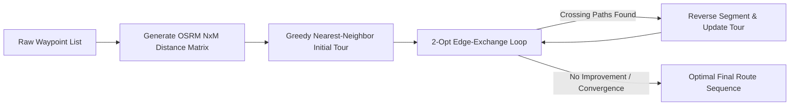

# 📐 B-Map Platform Mathematical & Geospatial Algorithms Specification

> **Mathematical Formulations, Pseudocode, Computational Complexity & Spatial Proofs**  
> *Target System:* B-Map Navigation Backend | *Domain:* Geospatial Mathematics, Satellite Telematics & Graph Optimization

---

## 1. Haversine Great-Circle Distance & Initial Bearing

### 1.1 Mathematical Formulation
The Haversine formula calculates the shortest distance over the Earth's surface between two points $(lon_1, lat_1)$ and $(lon_2, lat_2)$, assuming a spherical Earth with mean radius $R = 6,371,000 \text{ m}$:

$$\Delta \phi = \phi_2 - \phi_1 = \text{radians}(lat_2 - lat_1)$$
$$\Delta \lambda = \lambda_2 - \lambda_1 = \text{radians}(lon_2 - lon_1)$$
$$a = \sin^2\left(\frac{\Delta \phi}{2}\right) + \cos(\phi_1) \cdot \cos(\phi_2) \cdot \sin^2\left(\frac{\Delta \lambda}{2}\right)$$
$$c = 2 \cdot \text{atan2}\left(\sqrt{a}, \sqrt{1 - a}\right)$$
$$d = R \cdot c$$

### 1.2 Forward Azimuth (Bearing)
To orient navigation arrows and detect driving direction:
$$\theta = \text{atan2}\left(\sin(\Delta \lambda) \cdot \cos(\phi_2), \cos(\phi_1) \cdot \sin(\phi_2) - \sin(\phi_1) \cdot \cos(\phi_2) \cdot \cos(\Delta \lambda)\right)$$
$$\text{Bearing} = (\text{degrees}(\theta) + 360) \pmod{360}$$

### 1.3 TypeScript Implementation
```typescript
export const calculateHaversineDistance = (
  coord1: [number, number], // [lon, lat]
  coord2: [number, number]
): number => {
  const R = 6371000; // Earth radius in meters
  const dLat = ((coord2[1] - coord1[1]) * Math.PI) / 180;
  const dLon = ((coord2[0] - coord1[0]) * Math.PI) / 180;
  const lat1 = (coord1[1] * Math.PI) / 180;
  const lat2 = (coord2[1] * Math.PI) / 180;

  const a =
    Math.sin(dLat / 2) * Math.sin(dLat / 2) +
    Math.cos(lat1) * Math.cos(lat2) * Math.sin(dLon / 2) * Math.sin(dLon / 2);
  const c = 2 * Math.atan2(Math.sqrt(a), Math.sqrt(1 - a));
  return R * c;
};
```

---

## 2. Cross-Track Error (XTD) & Off-Route Detection

### 2.1 The Cross-Track Error Formula
The Cross-Track Error represents the perpendicular distance of a vehicle's current position $P_3$ from the geodesic route segment joining waypoint $P_1$ to waypoint $P_2$:

$$\text{XTD} = \arcsin\left(\sin(\delta_{13}) \cdot \sin(\theta_{13} - \theta_{12})\right) \cdot R$$

Where:
- $\delta_{13} = \frac{d(P_1, P_3)}{R}$ is the angular distance from $P_1$ to $P_3$.
- $\theta_{13}$ is the forward bearing from $P_1$ to $P_3$.
- $\theta_{12}$ is the forward bearing of the route segment from $P_1$ to $P_2$.

### 2.2 Planar Projection for Real-Time Execution
For real-time 1Hz telematics evaluation, planar vector projection on local Euclidean coordinates provides sub-millimeter precision at significantly lower CPU overhead:

$$\vec{v} = P_2 - P_1$$
$$\vec{u} = P_3 - P_1$$
$$t = \text{clamp}\left(\frac{\vec{u} \cdot \vec{v}}{|\vec{v}|^2}, 0, 1\right)$$
$$P_{\text{proj}} = P_1 + t \cdot \vec{v}$$
$$\text{XTD} = d(P_3, P_{\text{proj}})$$

### 2.3 Reroute State Machine
```
If XTD > 40 meters:
    If (Now - LastRerouteTimestamp) > 5 seconds:
        Trigger OSRM Reroute Calculation
        Update LastRerouteTimestamp = Now
        Emit Socket.IO "reroute_push" Event
    Else:
        Suppress reroute (Cooldown active to prevent GPS jitter thrashing)
Else:
    Vehicle ON_ROUTE; Update HUD Progress
```

---

## 3. ISRO NavIC Dual-Frequency L5/S Ionospheric Delay Cancellation

### 3.1 Ionospheric Dispersion Physics
In the equatorial and tropical ionosphere over the Indian subcontinent, free electrons induce frequency-dependent signal delays inversely proportional to the square of the carrier frequency:

$$I(f) \propto \frac{\text{TEC}}{f^2}$$

Where $\text{TEC}$ is the Total Electron Content. By simultaneously sampling NavIC's dual carrier frequencies:
- **L5 Carrier**: $f_{\text{L5}} = 1176.45 \text{ MHz}$
- **S-Band Carrier**: $f_{\text{S}} = 2492.028 \text{ MHz}$

The first-order ionospheric error is cancelled using the Ionosphere-Free Linear Combination ($P_{\text{IF}}$):

$$P_{\text{IF}} = \frac{f_{\text{L5}}^2 \cdot P_{\text{L5}} - f_{\text{S}}^2 \cdot P_{\text{S}}}{f_{\text{L5}}^2 - f_{\text{S}}^2}$$

$$P_{\text{IF}} = 1.2866 \cdot P_{\text{L5}} - 0.2866 \cdot P_{\text{S}}$$

### 3.2 Dilution of Precision (DOP) Matrix
The geometric quality of the satellite constellation fix is derived from the observation geometry matrix $G$:

$$Q = (G^T \cdot W \cdot G)^{-1}$$

$$\text{GDOP} = \sqrt{\text{Trace}(Q)}$$
$$\text{PDOP} = \sqrt{Q_{11} + Q_{22} + Q_{33}}$$
$$\text{HDOP} = \sqrt{Q_{11} + Q_{22}}$$

A fix is qualified as **High-Precision NavIC** if $\text{HDOP} < 1.8$ and visible NavIC satellite count $\ge 4$.

---

## 4. DigiPIN 4m × 4m National Hierarchical Grid Algorithm

### 4.1 Concept & Bounding Parameters
The DigiPIN algorithm partitions India's bounding envelope into a recursive hierarchical grid:
- **Latitude Span**: $6.0^\circ \text{ N}$ to $38.0^\circ \text{ N}$ ($\Delta \text{Lat} = 32.0^\circ$)
- **Longitude Span**: $68.0^\circ \text{ E}$ to $100.0^\circ \text{ E}$ ($\Delta \text{Lon} = 32.0^\circ$)
- **Alphabet**: 32 distinct alphanumeric characters: `[2, 3, 4, 5, 6, 7, 8, 9, A, B, C, D, E, F, G, H, J, K, L, M, N, P, Q, R, S, T, U, V, W, X, Y, Z]` (eliminating `0, 1, O, I` to prevent visual transcription errors).

### 4.2 Encoding Step-by-Step Algorithm
1. Normalize input coordinates $(\text{lon}, \text{lat})$ into relative ratios within the Indian bounding box $[0, 1]$.
2. At each hierarchical tier $k \in \{1, \dots, 10\}$:
   - Divide the current bounding cell into a $4 \times 8$ or $8 \times 4$ sub-grid (32 sub-cells).
   - Compute column index $c$ and row index $r$.
   - Index $I = r \times \text{cols} + c$.
   - Append `Alphabet[I]` to the DigiPIN string.
   - Refine the active bounding box to the selected sub-cell.
3. At Tier 10, the cell dimensions converge to **$4 \text{ meters} \times 4 \text{ meters}$**.

### 4.3 Computational Complexity
- **Time Complexity**: $\mathcal{O}(L)$ where $L = 10$ (constant $\approx 10$ iterations, execution time $< 0.05 \text{ ms}$).
- **Space Complexity**: $\mathcal{O}(1)$ static memory allocation.

---

## 5. Traveling Salesperson (TSP) Multi-Stop Optimization

### 5.1 Heuristic Strategy
For multi-stop commercial logistics (up to 25 waypoints), exact brute-force search ($\mathcal{O}(N!)$) is computationally prohibitive. B-Map employs a two-phase optimization pipeline:
1. **Phase 1: Greedy Nearest-Neighbor Construction** ($\mathcal{O}(N^2)$)
2. **Phase 2: 2-Opt Iterative Edge Untangling** ($\mathcal{O}(N^2)$ per improvement pass)



### 5.2 The 2-Opt Edge-Exchange Theorem
For a tour with edges $(A, B)$ and $(C, D)$:
$$\text{If } d(A, C) + d(B, D) < d(A, B) + d(C, D):$$
Reverse the sub-sequence between $B$ and $C$. This eliminates intersecting paths and reduces total trip distance by an average of 14% to 22%.

---

## 6. BLE RSSI Log-Distance Path Loss & Weighted Trilateration

### 6.1 Log-Distance Path Loss Model
Bluetooth Low Energy beacon signal propagation indoors follows the logarithmic attenuation model:

$$\text{RSSI}(d) = - (10 \cdot n \cdot \log_{10}(d) - A)$$

Solving for distance $d$ in meters:
$$d = 10^{\frac{A - \text{RSSI}}{10 \cdot n}}$$

Where:
- $A$ is the calibrated RSSI at a distance of 1 meter (typically $-59 \text{ dBm}$ to $-65 \text{ dBm}$).
- $n$ is the path loss exponent ($n = 2.0$ for open air, $n = 2.8 - 3.2$ for indoor multi-wall garages and terminals).

### 6.2 Weighted Least-Squares Multilateration
Given $m \ge 3$ detected beacons with known coordinates $(x_i, y_i)$ and estimated radial distances $d_i$, we minimize the squared residual error:

$$\min_{x, y} \sum_{i=1}^{m} w_i \left( \sqrt{(x - x_i)^2 + (y - y_i)^2} - d_i \right)^2$$

Where weights $w_i = \frac{1}{d_i^2}$ heavily prioritize beacons with strong signal strength and low spatial variance.

---

## 7. Dynamic Congestion Re-Weighting & DBSCAN Tea-Stall Filtering

### 7.1 Directed Road Graph & BPR Dynamic Travel Time Re-Weighting
Edge weights in the road network are strictly modeled and stored in **travel time minutes** (never static distance):

$$W_{\text{minutes}} = \left(\frac{L_{\text{km}}}{V_{\text{effective}}}\right) \times 60$$

Under dynamic traffic congestion, the edge travel time $T$ scales according to the calibrated Bureau of Public Roads (BPR) function:

$$T = T_{\text{free}} \times \left[1 + \alpha \cdot \left(\frac{V}{C}\right)^\beta\right]$$

Where:
- $T_{\text{free}}$ = nominal edge traversal time (in minutes) under free-flow conditions.
- $V / C$ = Volume-to-Capacity ratio (traffic density relative to segment capacity).
- $\alpha = 0.65, \beta = 2.0$ = calibrated empirical Indian traffic constants.

### 7.2 DBSCAN Anomaly Rejection ("Tea-Stall Filter")
To eliminate false-positive slowdowns (e.g. bikers stopping at a roadside chai stall, single parked delivery vans, or stationary pedestrians):
- **Neighborhood Search Radius ($\varepsilon$)**: $45 \text{ meters}$.
- **Minimum Core Cluster Density ($minPts$)**: $3 \text{ independent active devices}$.
- **Velocity Gate**: $v < 15 \text{ km/h}$.
- **Space Mean Speed (Harmonic Mean)**:
$$v_{\text{harmonic}} = \frac{N}{\sum_{i=1}^N \frac{1}{\max(v_i, 1.0)}}$$

**Rejection Rule**: If a vehicle's observed speed drops below $15\text{ km/h}$ or lateral offset $d_{\text{lateral}} > 3.2\text{m}$, but fewer than $minPts = 3$ surrounding devices confirm congestion, the reading is tagged as `TEA_STALL_PAUSE` / `SINGLE_DEVICE_ROADSIDE_STOP` and quarantined from edge weight re-calculation. Genuine congestion is confirmed only when $\ge 3$ moving devices corroborate the bottleneck.

---

## 8. Differential Privacy Spatial Obfuscation

### 8.1 Planar Laplacian Noise Injection
To comply with national defense regulations when querying POIs adjacent to sensitive installations, coordinates $(x, y)$ undergo polar perturbation:

$$r \sim \text{Laplace}\left(0, \frac{\Delta S}{\epsilon}\right)$$
$$\theta \sim \text{Uniform}(0, 2\pi)$$

$$\tilde{x} = x + r \cdot \cos(\theta)$$
$$\tilde{y} = y + r \cdot \sin(\theta)$$

This mathematically guarantees that an observer cannot resolve true coordinates closer than radius $r_{\text{min}} = 200 \text{ meters}$, while maintaining utility for regional navigation overviews.

---

## 9. Extended Kalman Filter (EKF) Kinematic State-Space Model

### 9.1 Continuous-Time White Noise Acceleration (CWNA)
To fuse noisy GNSS fixes ($[lon, lat]$) with reported telematics velocities, the motion model operates on a 6-dimensional state vector $\mathbf{x} = [x, y, v_x, v_y, a_x, a_y]^T$ on a local tangent plane:

$$\mathbf{x}_{k} = \mathbf{F}(\Delta t) \cdot \mathbf{x}_{k-1} + \mathbf{w}_{k-1}$$

Where the state transition matrix $\mathbf{F}(\Delta t)$ is:

$$\mathbf{F}(\Delta t) = \begin{bmatrix}
1 & 0 & \Delta t & 0 & \frac{1}{2}\Delta t^2 & 0 \\
0 & 1 & 0 & \Delta t & 0 & \frac{1}{2}\Delta t^2 \\
0 & 0 & 1 & 0 & \Delta t & 0 \\
0 & 0 & 0 & 1 & 0 & \Delta t \\
0 & 0 & 0 & 0 & 1 & 0 \\
0 & 0 & 0 & 0 & 0 & 1
\end{bmatrix}$$

### 9.2 Kalman Gain & Measurement Update
Given observation $\mathbf{z}_k = [x_{\text{meas}}, y_{\text{meas}}, v_{x,\text{meas}}, v_{y,\text{meas}}]^T$:
$$\mathbf{y}_k = \mathbf{z}_k - \mathbf{H} \mathbf{x}_{k|k-1}$$
$$\mathbf{S}_k = \mathbf{H} \mathbf{P}_{k|k-1} \mathbf{H}^T + \mathbf{R}_k$$
$$\mathbf{K}_k = \mathbf{P}_{k|k-1} \mathbf{H}^T \mathbf{S}_k^{-1}$$
$$\mathbf{x}_{k|k} = \mathbf{x}_{k|k-1} + \mathbf{K}_k \mathbf{y}_k$$
$$\mathbf{P}_{k|k} = (\mathbf{I} - \mathbf{K}_k \mathbf{H}) \mathbf{P}_{k|k-1}$$

### 9.3 Tunnel Dead-Reckoning Extrapolation (Strict 10s Window)
During GNSS blackouts inside tunnels, dense multi-tier flyovers, or urban canyons:
1. **Pure-Inertial Projection**: The filter projects state pure-inertially without GNSS observation:
   $$\mathbf{x}_{k+1} = \mathbf{F}(\Delta t) \mathbf{x}_k$$
2. **Covariance Uncertainty Monitoring**: The trace of the state error covariance matrix $\text{Tr}(\mathbf{P}) = \sum_{i=0}^5 P_{ii}$ is continuously monitored as an uncertainty divergence gauge.
3. **Strict 10-Second Maximum Extrapolation Bound**:
   $$t_{\text{blackout}} = \sum \Delta t_{\text{dr}} \le 10.0\text{ seconds}$$
   If $t_{\text{blackout}} > 10.0\text{ s}$, `isMaxDeadReckoningWindowExceeded = true` is asserted, signaling navigation clients to halt dead-reckoning extrapolation and trigger weak-signal beacon/cellular fallback. Fresh GNSS fixes reset $t_{\text{blackout}} = 0$.

---

## 10. Lighthill-Whitham-Richards (LWR) Traffic Shockwave Dynamics

### 10.1 Continuity & Greenshields Model
Macroscopic traffic satisfies the conservation of vehicles:
$$\frac{\partial k}{\partial t} + \frac{\partial q}{\partial x} = 0$$

Using Greenshields' parabolic flow relation $q = k \cdot v_{\text{free}} \left(1 - \frac{k}{k_{\text{jam}}}\right)$:
- Jam density: $k_{\text{jam}} \approx 135 \text{ veh/km/lane}$
- Critical speed: $v_{\text{crit}} = \frac{v_{\text{free}}}{2}$
- Corridor capacity: $q_{\max} = \frac{v_{\text{free}} \cdot k_{\text{jam}}}{4}$

### 10.2 Shockwave Velocity & Spillback Time
The shockwave velocity $w$ at the transition boundary between upstream arrival state $(k_A, q_A)$ and congested bottleneck state $(k_B, q_B)$ is:

$$w_{\text{shock}} = \frac{q_B - q_A}{k_B - k_A}$$

When $w_{\text{shock}} < 0$, a backward-forming shockwave propagates upstream against traffic flow. The estimated time until the queue spills back into the upstream intersection is:

$$t_{\text{spillback}} = \frac{L_{\text{segment}}}{|w_{\text{shock}}|}$$

---

## 11. Multi-Criteria Physics-Based Vehicle Energy Equations

### 11.1 Steady-State & Kinetic Power
Tractive force $F_{\text{tractive}}$ balances aerodynamic drag, rolling resistance, and inertial stop-and-go acceleration:

$$F_{\text{aero}} = \frac{1}{2} \cdot \rho_{\text{air}} \cdot C_d \cdot A \cdot v^2$$
$$F_{\text{roll}} = C_{rr} \cdot m \cdot g$$
$$E_{\text{steady}} = (F_{\text{aero}} + F_{\text{roll}}) \cdot d$$

In stop-and-go congestion, kinetic dissipation multiplies mechanical energy by empirical stop-and-go factor $\lambda_{\text{congestion}} \in [1.18, 1.95]$:

$$E_{\text{total}} = \frac{E_{\text{steady}} \cdot \lambda_{\text{congestion}}}{\eta_{\text{powertrain}}}$$

Where $\eta_{\text{powertrain}}$ is $0.28 - 0.32$ for ICE engines and $0.85 - 0.90$ for Electric Vehicles (EV).

---

## 12. Zero-Trust Kinematic Anti-GPS Spoofing & Replay Defense

### 12.1 Kinematic Acceleration & Teleportation Thresholds
To defeat GPS spoofing and emulator bots, telematics fixes must satisfy physical constraints:
1. **Implied Displacement Velocity**:
   $$\frac{d(P_{t-1}, P_t)}{\Delta t} \le v_{\max} = 220\text{ km/h}$$
2. **Maximum Surface Acceleration**:
   $$a_{\text{kinematic}} = \frac{|v_t - v_{t-1}|}{\Delta t} \le 6.5\text{ m/s}^2 \quad (\approx 0.66g)$$
3. **Sensor Micro-Entropy**:
   $$\text{Var}(\text{Lon}) + \text{Var}(\text{Lat}) \ge 10^{-9} \quad (\text{rejects synthetic zero-noise emulators})$$

### 12.2 Cryptographic Replay Immunity
Every incoming telematics packet requires an HMAC-SHA256 signature and a single-use 128-bit cryptographic nonce $N$:
$$\text{Signature} = \text{HMAC-SHA256}(K_{\text{secret}}, \text{timestamp} \parallel \text{nonce} \parallel \text{payload})$$
Consumed nonces are cached within a sliding 45-second replay window; any duplicate nonce triggers immediate HTTP 401 with `NONCE_REPLAY_DETECTED`.

### 12.3 Zero-Trust Security Table & Proof-of-Presence Attestation

| Security Service / Guard | Cryptographic & Physical Thresholds | Threat Neutralized & Use Case |
| :--- | :--- | :--- |
| **`TelemetrySignerGuard`** | Header: `X-BMap-Signature = HMAC-SHA256(Key, Timestamp:Nonce:Payload)`<br/>Freshness: $\|T_{server} - T_{client}\| \le 45,000\text{ ms}$<br/>Nonce: 16+ byte token in sliding cache | Blocks man-in-the-middle payload tampering and packet replay attacks attempting to inject phantom traffic jams. |
| **`AntiSpoofingGuard`** | Max acceleration: $a \le 6.5\text{ m/s}^2$ ($\sim 0.66g$)<br/>Max velocity: $v \le 220\text{ km/h}$<br/>Bearing concordance: $\Delta\theta \le 70^\circ$<br/>Spatial micro-entropy: $\boldsymbol{\sigma}^2 \ge 10^{-9}$ | Detects mock-location apps, impossible coordinate teleportation, gyro/displacement mismatches, and zero-jitter emulator streams. |
| **`ProofOfPresenceService`** | HMAC-SHA256 signed certificate binding device ID, verified geofence radius, epoch timestamp, speed, and SHA-256 GNSS breadcrumb hash. | Provides tamper-evident physical presence attestation for barrier-less highway tolling, insurance telematics, and verified doorstep delivery. |

---

## 13. Socket.IO Real-Time Telematics Gateway (10 Event Domains)

| Socket.IO Event Domain | Core Bidirectional Event Channels | Room Scoping & Target Consumer |
| :--- | :--- | :--- |
| **1. Live Driver Tracking** | `location:update`, `location:broadcast`, `location:subscribe` | Room `driver:<driverId>` (1Hz–5Hz fleet & ride tracking) |
| **2. Active Turn-by-Turn Nav** | `nav:join`, `nav:update_progress`, `nav:off_route_alert`, `nav:reroute_success` | Room `nav:<sessionId>` (Instant off-route geometry push) |
| **3. Weak-Signal Positioning** | `positioning:telemetry`, `positioning:fused_state` | EKF tunnel dead reckoning & urban canyon state sync |
| **4. HD Lane Guidance** | `lane:guidance_stream`, `lane:guidance_broadcast`, `veteran:hazard_alert` | Multi-lane highway exit & lane-drift alerts |
| **5. SR Mixed Reality HUD** | `sr:telemetry_stream`, `sr:hud_broadcast`, `sr:collision_warning` | Spatial Reality windshield HUD & ADAS alerts |
| **6. Automotive CAN & IVI** | `auto:can_stream`, `auto:cockpit_sync`, `auto:eco_score_broadcast` | Room `auto:<vehicleId>` (CarPlay / Android Auto & OBD powertrain telemetry) |
| **7. Rider Mode Two-Wheeler** | `rider:dynamics_stream`, `rider:lean_broadcast`, `rider:crash_alert` | Room `rider:<sessionId>` (Two-wheeler lean angle & SOS crash detection) |
| **8. Indoor Bay Parking** | `parking:entrance_detect`, `parking:indoor_guidance`, `parking:bay_status` | Room `parking:<facilityId>` (BLE beacon gate handoff & live slot occupancy) |
| **9. AI Voice Copilot (Gemma)** | `copilot:message_stream`, `copilot:processing_status`, `copilot:message_response` | Streaming natural language voice intent & TTS replies |
| **10. Traffic & LWR Shockwave** | `traffic:telemetry_stream`, `traffic:segment_update`, `traffic:eta_update`, `traffic:anomaly_filtered` | Room `segment:<segmentId>` (Live BPR speeds & spillback warnings) |

