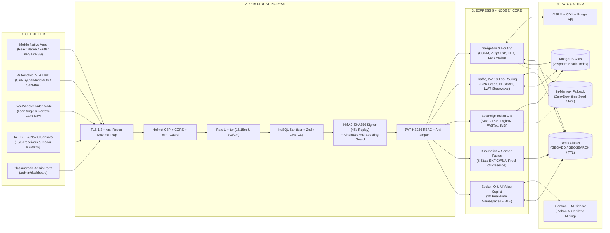
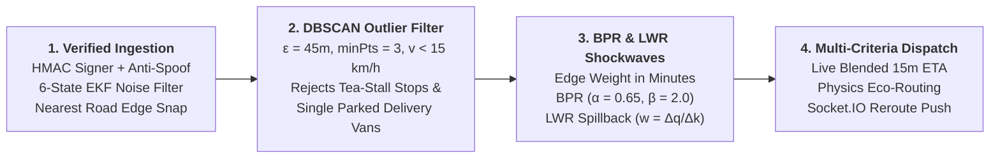
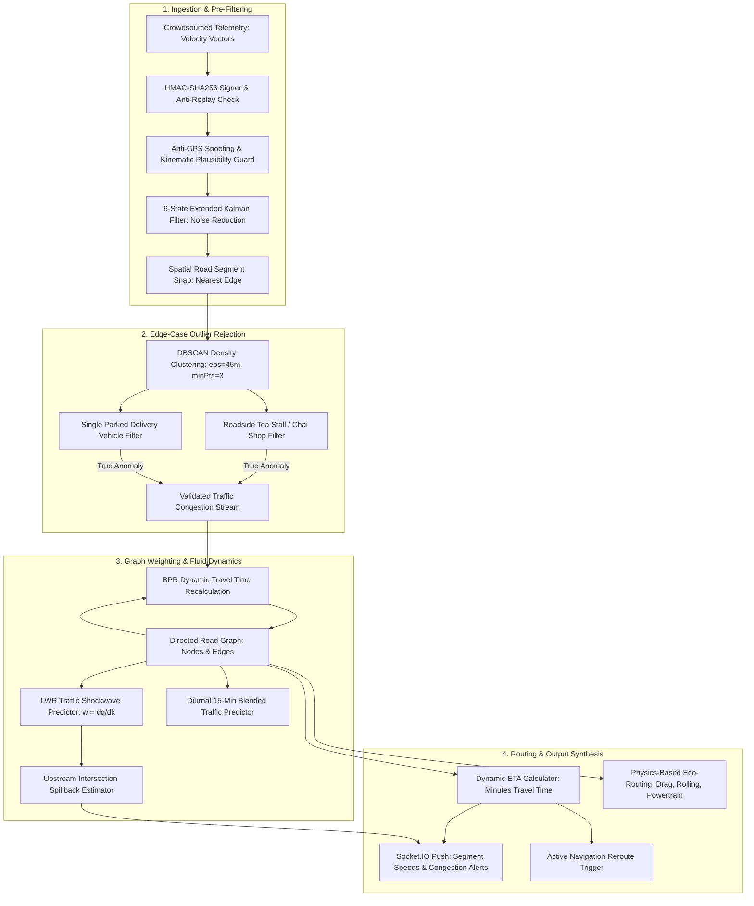
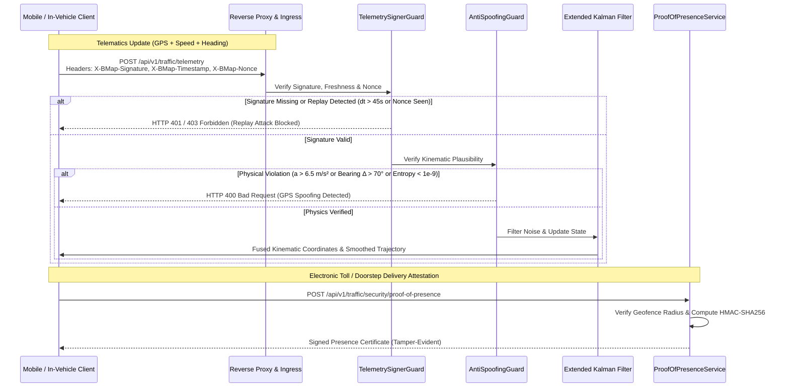
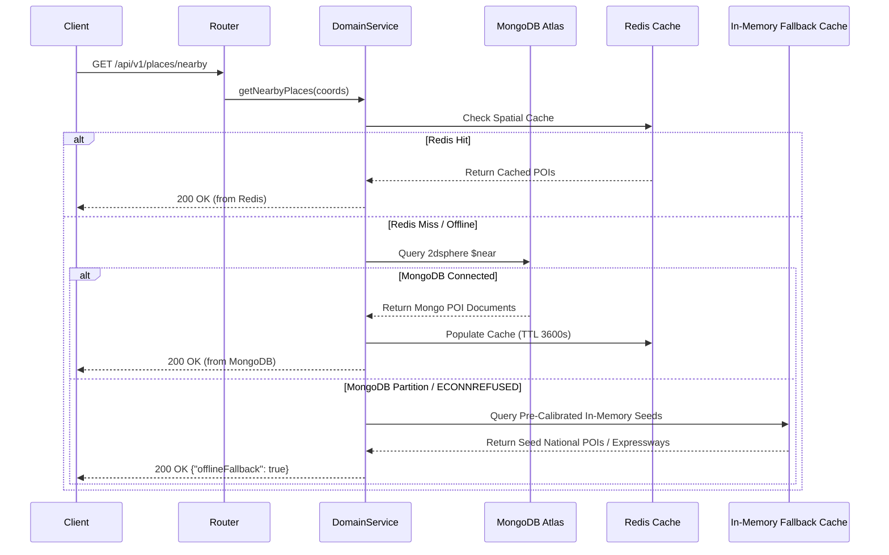
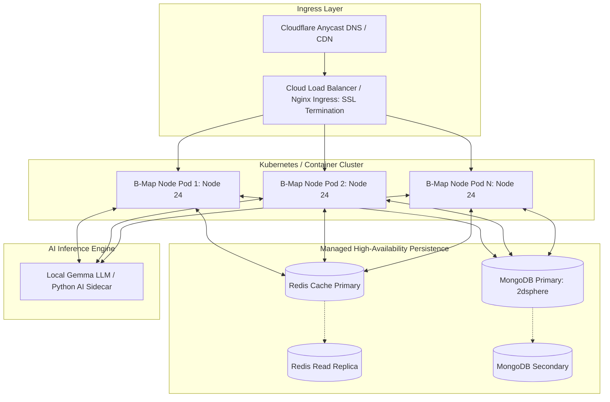
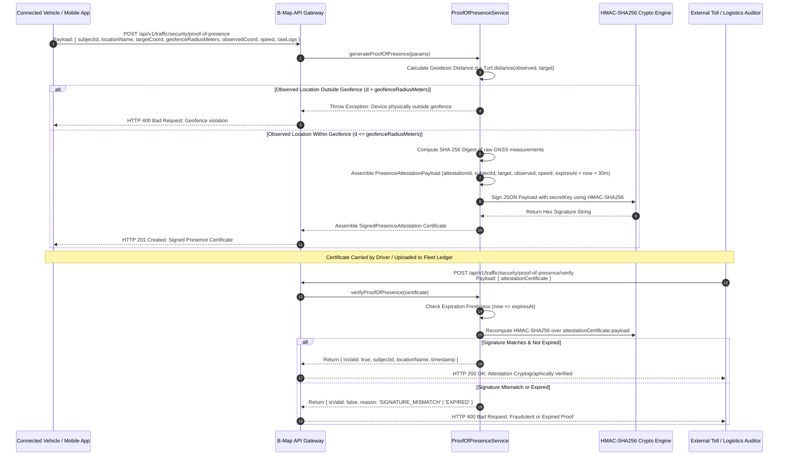
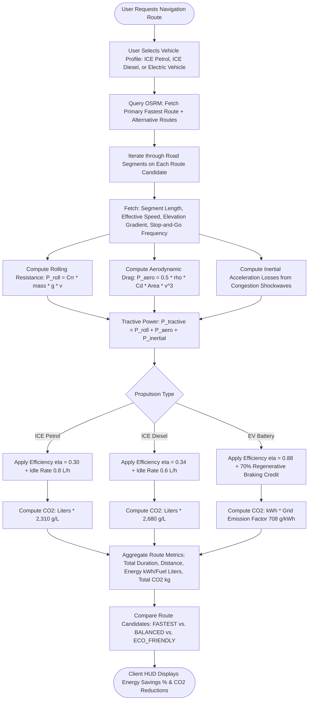
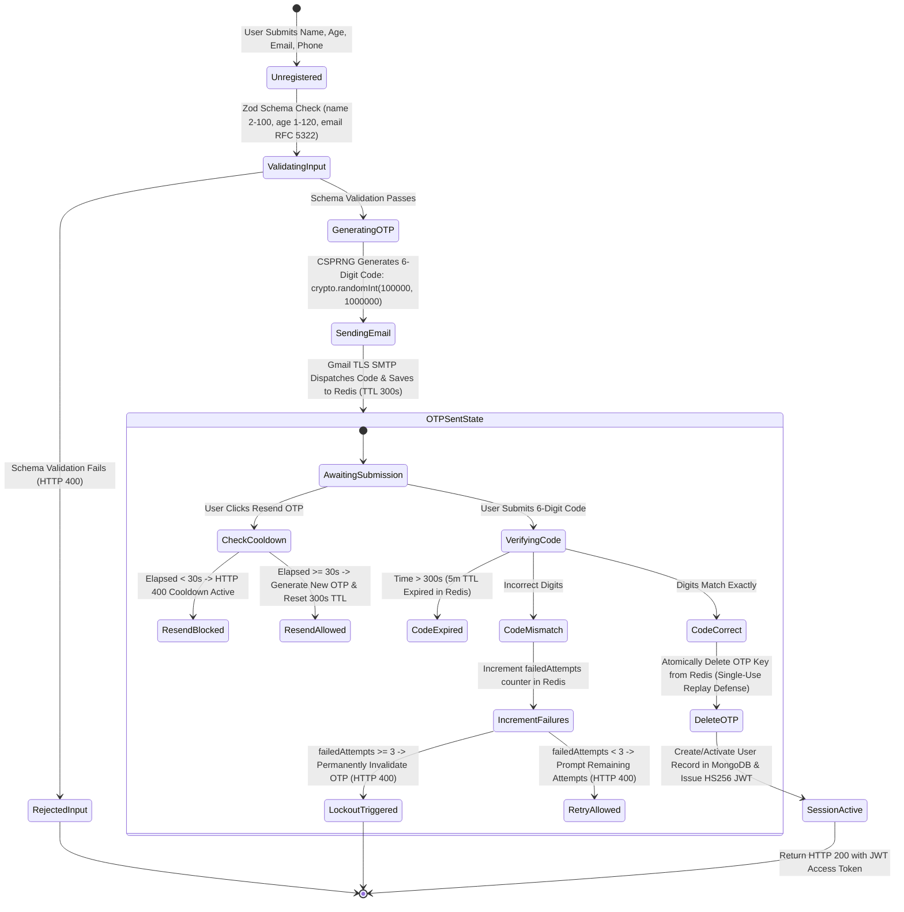
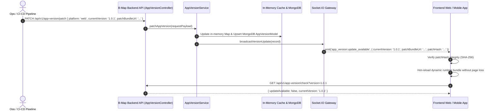

# 🏛️ B-Map Platform Architecture Specification

> **Sovereign Indian Geospatial, Turn-by-Turn Navigation, Real-Time Traffic & Telematics Engine**  
> *Version:* 2.0.0 | *Runtime:* Node.js 24 + TypeScript | *Revision:* Enterprise Production-Ready

---

## 1. Architectural Philosophy Enables Sovereign AI-Ready Navigation at Scale

**B-Map v2.0.0** is an enterprise-grade geospatial, real-time navigation, macroscopic traffic flow estimation, and AI-driven telematics platform engineered specifically for the Indian subcontinent while retaining universal global GIS interoperability. The architecture fuses sovereign Indian positioning and addressing infrastructure (ISRO NavIC, DigiPIN, NHAI FASTag, Department of Posts Pincodes, and IMD Highway Weather) with real-time dynamic graph routing, physics-based eco-telematics, Lighthill-Whitham-Richards (LWR) traffic shockwave dynamics, and zero-trust cryptographic telemetry defenses.

| Architectural Pillar | Engineering Implementation & Operational Guarantee |
| :--- | :--- |
| **1. Decoupled Domain Modularity** | Over 45 discrete domain modules operate independently behind a unified Express 5 router (`/api/v1/*`), enforcing strict domain separation, high unit testability, and isolated service lifecycles. |
| **2. Sub-Millisecond Spatial Caching** | High-frequency spatial queries (turn-by-turn routes, live driver tracking, radial POI lookups) leverage Redis in-memory caches, `GEOADD`, and `GEOSEARCH` primitives before querying persistent storage. |
| **3. Sovereign Indian GIS Stack** | Native first-class integration with ISRO NavIC dual-frequency L5/S-band positioning, 4m×4m DigiPIN hierarchical addressing, 6-digit Pincodes, NHAI FASTag tolling, and IMD severe weather advisories. |
| **4. Travel-Time Directed Road Graph** | Directed road network graph where edges are strictly weighted in **Travel Time Minutes** (never static distance), continuously recalculated via the Bureau of Public Roads (BPR) function and DBSCAN anomaly filtering. |
| **5. LWR Shockwave & Spillback Math** | Macroscopic Lighthill-Whitham-Richards (LWR) conservation model computing shockwave propagation velocity ($w = \Delta q / \Delta k$) to predict upstream intersection spillbacks before gridlock occurs. |
| **6. 6-State EKF Sensor Fusion** | Continuous-Time White Noise Acceleration (CWNA) Extended Kalman Filter (EKF) smoothing noisy urban-canyon fixes, performing tunnel dead reckoning (up to 10s), and verifying Doppler bearing concordance. |
| **7. Zero-Trust Telemetry Perimeter** | End-to-end HMAC-SHA256 telemetry signing with a 45-second anti-replay window, kinematic anti-GPS spoofing guards, cryptographic Proof-of-Presence certificates, and Node.js prototype freezing. |
| **8. Dual-Tier Offline Resilience** | Zero-downtime fallback architecture serving pre-calibrated in-memory national expressway and POI seeds (`"offlineFallback": true`) whenever MongoDB or Redis experience transient network partitions. |
| **9. Bidirectional AI & HUD Streaming** | Socket.IO gateway spanning 10 specialized event domains for 1Hz–5Hz breadcrumb streaming, Spatial Reality (SR) HUD telemetry, Gemma LLM voice copilot interaction, and sub-second off-route rerouting. |

---

## 2. Multi-Tier System Topology Connects Clients, Security, and AI Sidecars

The platform separates client consumption, zero-trust ingress filtering, core domain orchestration, real-time caching, and local Gemma LLM inference into horizontally scalable tiers.



*Figure 1: B-Map v2.0.0 End-to-End Multi-Tier System Architecture & Zero-Trust Data Flow*

---

## 3. Client, Zero-Trust Perimeter & Runtime Hardening Tiers

### 3.1–3.3 Client, Zero-Trust Perimeter & Runtime Hardening Tiers
- **Heterogeneous Client Endpoints**: Native iOS/Android apps (React Native/Flutter), Connected Vehicle IVI/HUDs (Android Automotive OS, Apple CarPlay, CAN-bus/OBD), Two-Wheeler `rider-mode` clients, BLE indoor beacon arrays, and the server-rendered Glassmorphic Admin Portal (`/admin/dashboard`).
- **11-Layer Ingress Defense Perimeter**:
  1. **TLS 1.3 & Brotli Reverse Proxy**: Enforces high-grade TLS 1.3 cipher suites, Brotli/Gzip compression, and proxy header forwarding (`X-Forwarded-For`).
  2. **antiReconTrap**: Automatically detects and drops automated vulnerability scanners and malicious probes targeting sensitive paths (`.env`, `.git`, `wp-admin`, `actuator`, `shell.php`).
  3. **Hardened Helmet CSP/HSTS Headers**: Injects Content-Security-Policy (CSP), HSTS (`max-age=31536000; includeSubDomains; preload`), `X-Frame-Options: DENY`, `X-Content-Type-Options: nosniff`, and strips `X-Powered-By`.
  4. **RFC-Compliant CORS Whitelist Reflection**: Dynamically reflects whitelisted origins configured in `CORS_ORIGIN` with credentials authorization.
  5. **Dual-Tier Sliding Window Rate Limiters**:
     - *Auth Limiter*: Restricts `/api/v1/auth/*` to **15 requests per 15 minutes** per IP against credential stuffing.
     - *General API Limiter*: Restricts standard API operations to **300 requests per 1 minute** per client against volumetric DoS.
  6. **Recursive noSqlSanitizer**: Strips all MongoDB query operators (`$`, `$where`, `$gt`, `$ne`, etc.) and dot notation to neutralize NoSQL injection exploits.
  7. **HPP Array Standardization**: Normalizes duplicate query string arrays to prevent HTTP Parameter Pollution attacks.
  8. **1MB JSON Payload Memory Guard**: Strict payload cap (`express.json({ limit: '1mb' })`) preventing memory exhaustion attacks.
  9. **TelemetrySignerGuard (HMAC-SHA256 + 45s Replay Window)**: Cryptographically authenticates incoming telemetry packets using HMAC-SHA256 signatures (`X-BMap-Signature`), timestamp freshness (`X-BMap-Timestamp`), and single-use cryptographic nonces (`X-BMap-Nonce`) within a 45-second sliding window.
  10. **AntiSpoofingGuard Kinematic Physics Verifier**: Evaluates physical vehicle dynamics—acceleration ($a \le 6.5 \text{ m/s}^2$), top speed ($v \le 220 \text{ km/h}$), displacement-to-bearing concordance ($\Delta \theta \le 70^\circ$), and spatial micro-entropy ($\text{variance} \ge 10^{-9}$) to identify and reject GPS emulators, mock locations, and teleportation exploits.
  11. **Pinned HS256 JWT RBAC**: Strict role-based authorization enforcing permissions across `anonymous`, `user`, and `admin` tiers.
- **Node.js Runtime Hardening (`AntiTamperSentinel`)**: Deep-freezes core JavaScript prototypes (`Object`, `Array`, `Function`, `Promise`, `Map`, `Set`, `String`, `Number`, `Boolean`, `Symbol`) to eliminate prototype pollution gadget chains, disables `eval()` and indirect `Function` constructors, freezes runtime environment configs, and terminates unauthorized V8 inspector/debugger attachments.

---

### 3.4 Application Core Domain Directory (45 Modules in src/modules/)

The core application logic is partitioned into **45 autonomous domain modules** organized across **6 domain clusters** under `src/modules/`, accompanied by dynamic platform version control:

| Domain Cluster | Modules (`src/modules/*`) | Core Functional Responsibilities |
| :--- | :--- | :--- |
| **AI, Copilot & Analytics** | `ai-copilot`, `ai-data-mining`, `vernacular` | Natural language voice navigation via local Gemma LLM sidecar, speech intent classification, congestion pattern mining, trip profiling, and 12-language regional TTS localization. |
| **Traffic, ETA & Eco-Routing** | `traffic`, `routes`, `navigation`, `lane-routing`, `car-navigation`, `unified-engine` | Directed road graph weighted in travel-time minutes, BPR congestion re-weighting, DBSCAN tea-stall anomaly rejection, LWR shockwave spillback prediction, physics eco-routing, 2-Opt TSP, and XTD off-route detection. |
| **Sovereign Indian GIS** | `navic`, `digipin`, `tolls`, `pincode`, `weather`, `obfuscation`, `boundaries`, `roads`, `timezone` | ISRO NavIC L5/S ionospheric correction, 4m×4m DigiPIN grid addressing, NHAI FASTag class 4–9 dynamic tolling, 6-digit postal geocoding, IMD highway fog/flood alerts, and military zone polygon masking/jitter. |
| **Kinematics, IoT & Positioning** | `positioning`, `location-access`, `motion-fitness`, `nearby-devices`, `tracking` | 6-state EKF CWNA sensor fusion, tunnel dead reckoning, cryptographic Proof-of-Presence attestation, BLE indoor trilateration, IMU activity detection, and Redis `GEOADD`/`GEOSEARCH` live tracking. |
| **Mobility Modes & V2X** | `automotive`, `rider-mode`, `ar-walk-cycle`, `sr-navigation`, `public-transit`, `v2x`, `fleet` | CAN-bus cockpit sync, two-wheeler lean angle & flyover restrictions, AR pedestrian guidance, Spatial Reality HUD collision warnings, metro/bus multimodal routing, and V2X hazard broadcasting. |
| **Commerce, Places & Ops** | `places`, `parking`, `evcharging`, `fares`, `environment`, `hazards`, `emergency`, `super-app`, `ratings`, `maps-tiles`, `auth`, `admin`, `health`, `notifications`, `spatial-visualization` | MongoDB `$near` POIs, indoor bay-level parking, EV charger range planning (CCS-2/Type-2/GB/T), auto/metro fare matrices, AQI eco-corridors, SOS ambulance dispatch, 3D terrain meshes, and glassmorphic admin control. |
| **Version & OTA Governance** | `app-version` | Semantic version verification (`1.0.0`), mandatory minimum version enforcement, release changelog distribution, and dynamic OTA bundle patching (`PATCH /api/v1/app-version/patch`). |

#### Detailed 45+ Module Specification Reference

| Module Directory | Primary Route Aliases | Domain Scope & Implementation Details |
| :--- | :--- | :--- |
| `admin/` | `/admin`, `/api/v1/admin` | Server-rendered glassmorphic dashboard (`/admin/dashboard`), real-time metrics, audit logging, and manual incident overrides. |
| `ai-copilot/` | `/ai-copilot` | Conversational voice turn-by-turn copilot, token streaming (`COPILOT_TOKEN_STREAM`), and local Gemma LLM sidecar bridge. |
| `ai-data-mining/` | `/data-mining`, `/ai-data-mining` | Diurnal mobility pattern clustering, speed profiles, and trip trajectory mining. |
| `app-version/` | `/app-version`, `/version` | Semantic version control (`1.0.0`), OTA frontend bundle patching, and platform deprecation guards. |
| `ar-walk-cycle/` | `/ar-walk-cycle` | Pedestrian AR camera pose synchronization, 3D spatial turn arrows, and sidewalk guidance. |
| `auth/` | `/auth` | Secure passwordless email OTP verification, timing-safe passcode checks, and JWT HS256 tokens. |
| `automotive/` | `/automotive` | Connected vehicle cockpit sync, CAN-bus speed/gear stream ingestion, and automotive HUD telemetry. |
| `boundaries/` | `/boundaries` | National, state, district, taluk, and municipal ward GeoJSON administrative boundaries. |
| `car-navigation/` | `/car-nav`, `/car-navigation` | Multi-alternative highway routing, speed-camera proximity warnings, and junction view cues. |
| `digipin/` | `/digipin` | Department of Posts 4m×4m alphanumeric hierarchical grid addresses (`2-9`, `B-Z`). |
| `emergency/` | `/emergency` | One-touch SOS dispatch, emergency responder radial routing, and nearest trauma center routing. |
| `environment/` | `/environment` | Real-time CPCB Air Quality Index (AQI) monitoring and low-pollution eco-corridor routing. |
| `evcharging/` | `/ev`, `/evcharging` | Indian EV charger directory (Type-2, CCS-2, Bharat AC-001/DC-001, GB/T) and battery range reachability. |
| `fares/` | `/fares` | City-specific dynamic fare estimation matrices for auto-rickshaws, meter taxis, and metro lines. |
| `fleet/` | `/fleet` | Enterprise fleet vehicle telemetry, polygon geofence breach alerting, and route compliance. |
| `hazards/` | `/hazards` | Crowdsourced pothole, waterlogging, fallen tree, and road accident verification. |
| `health/` | `/health` | System uptime, memory allocation, Node.js event-loop lag, and database connectivity probes. |
| `lane-routing/` | `/lane-routing` | Lane-level maneuver guidance, highway exit fork positioning, and lane-departure mitigation. |
| `location-access/` | `/location`, `/location-access` | High-frequency GPS telemetry ingestion, batch historical fix uploads, and trace logging. |
| `maps-tiles/` | `/maps`, `/tiles`, `/maps-tiles` | Vector and raster tile serving, MapLibre GL compatibility, and CDN tile cache proxies. |
| `motion-fitness/` | `/motion`, `/motion-fitness` | Device accelerometer activity detection (automotive, bicycling, walking, stationary). |
| `navic/` | `/navic` | ISRO NavIC dual-frequency (L5: 1176.45 MHz, S: 2492.028 MHz) ionospheric delay elimination. |
| `navigation/` | `/navigation` | Active turn-by-turn navigation sessions, sub-second off-route rerouting (< 500ms), and instruction progression. |
| `nearby-devices/` | `/nearby-devices`, `/bluetooth` | BLE beacon indoor venue mapping, RSSI trilateration, and proximity notifications. |
| `notifications/` | `/notifications` | Push notification delivery, geofence boundary crossing alerts, and trip completion receipts. |
| `obfuscation/` | `/obfuscation` | Sensitive defense and military zone polygon spatial masking and pseudo-random jitter. |
| `parking/` | `/parking` | Multilevel indoor parking guidance, bay-level occupancy tracking, and parking entry routing. |
| `pincode/` | `/pincode` | Indian 6-digit postal code spatial index, polygon boundaries, and address lookups. |
| `places/` | `/places` | Geospatial POIs with MongoDB 2dsphere `$near` queries and in-memory national seeds fallback. |
| `positioning/` | `/positioning` | Sensor-fused positioning, dead reckoning extrapolation, and weak-signal Kalman filtering. |
| `public-transit/` | `/transit`, `/public-transit` | Metro rail networks (Delhi DMRC, Bengaluru Namma Metro, Mumbai Metro), bus transit, and multimodal routing. |
| `ratings/` | `/ratings` | Crowdsourced road surface roughness scoring, drive comfort, and POI reviews. |
| `rider-mode/` | `/rider-mode` | Two-wheeler motorcycle navigation, IMU lean-angle tracking, flyover restrictions, and narrow-alley routing. |
| `roads/` | `/roads` | National Highways (NH), Expressways, state highways, and surface quality classification. |
| `routes/` | `/routes` | OSRM routing client, TSP 2-Opt multi-stop route optimization, and GPS map matching with offline resilience. |
| `spatial-visualization/`| `/spatial-vis`, `/spatial-visualization` | 3D terrain elevation meshes, building footprint extrusions, and congestion heatmaps. |
| `sr-navigation/` | `/sr-navigation` | Spatial Reality HUD collision warnings, forward TTC calculation, and lateral departure warnings. |
| `super-app/` | `/super-app` | Unified mobility commerce, roadside assistance, hotel/dining stops, and EV charging reservation. |
| `timezone/` | `/timezone` | Indian Standard Time (IST, UTC+05:30) geographic boundary calculations and solar daylight ephemerides. |
| `tolls/` | `/tolls` | NHAI FASTag dynamic electronic toll plaza fees categorized by vehicle class (Class 4 to 9). |
| `tracking/` | `/tracking` | Real-time driver location streaming (1Hz–5Hz), Redis `GEOADD`/`GEOSEARCH`, and room broadcasts. |
| `traffic/` | `/traffic` | Directed road graph (edges weighted in minutes), BPR congestion, LWR shockwaves, and physics eco-routing. |
| `unified-engine/` | `/unified`, `/unified-engine` | Multimodal route synthesis orchestrating metro transit, walking transfers, and first/last mile rides. |
| `v2x/` | `/v2x` | Vehicle-to-Everything (V2X) safety message broadcasting and emergency vehicle corridor preemption. |
| `vernacular/` | `/vernacular` | 12 Indian regional language audio instruction localization and Text-to-Speech translation. |
| `weather/` | `/weather` | IMD severe highway weather advisories (fog, monsoon rain, flood alerts) with speed re-weighting. |

---

## 4. Real-Time Traffic Engine Unites BPR Graph Weights, DBSCAN & LWR Dynamics

Unlike static distance routers, B-Map v2.0.0 models the road network as a live fluid-dynamic system where crowdsourced velocity vectors pass through cryptographic and kinematic verification before updating edge travel times.



*Figure 2: Four-Stage Real-Time Telemetry Ingestion, DBSCAN Tea-Stall Anomaly Filtering & LWR Shockwave Pipeline*

### Mathematical Subsystems in Real-Time Traffic

| Mathematical Subsystem | Governing Equations & Parameters | Operational Role in B-Map v2.0.0 |
| :--- | :--- | :--- |
| **Directed Road Graph & BPR Re-Weighting** | $W_{minutes} = (L_{km} / V_{effective}) \times 60$<br/>$T = T_{free} \times [1 + \alpha \cdot (V / C)^\beta]$<br/>*Calibrated Indian constants:* $\alpha = 0.65, \beta = 2.0$ | Intersections (`IntersectionNode`) and directed edges (`RoadSegmentEdge`) store weights strictly in travel-time minutes, dynamically scaling under mixed Indian traffic density. |
| **DBSCAN Anomaly Rejection ("Tea-Stall Filter")** | Radius $\varepsilon = 45\text{ m}$, $minPts = 3\text{ devices}$<br/>Velocity gate: $v < 15\text{ km/h}$ | Rejects false-positive slowdowns caused by bikers stopping at roadside chai stalls, single parked delivery vans, or stationary pedestrians when fewer than 3 nearby moving devices confirm congestion. |
| **Macroscopic LWR Traffic Shockwave Model** | $\partial q / \partial x + \partial k / \partial t = 0 \mid k = k_{jam}(1 - v/v_{free})$<br/>Shockwave velocity: $w = (q_2 - q_1) / (k_2 - k_1)$<br/>Spillback time: $t_{spillback} = (D_{upstream} / \|w\|) \times 60$ | When $w < 0$, congestion propagates upstream. Predicts exact minutes until queue spillback blocks upstream junctions and triggers proactive Socket.IO reroutes. |
| **Physics-Based Tractive Eco-Routing** | $P_{roll} = C_{rr} \cdot m \cdot g \cdot v$<br/>$P_{aero} = \frac{1}{2} \rho_{air} \cdot C_d \cdot A \cdot v^3 + \text{inertial losses}$ | Models powertrain efficiencies across Petrol ICE ($\eta = 0.30$, idle $0.8\text{ L/h}$), Diesel ICE ($\eta = 0.34$, idle $0.6\text{ L/h}$), and EV ($\eta = 0.88$ with 70% regenerative braking kinetic recovery). |



### 4.1 Directed Road Graph Network
- **Topology**: Intersections represent **Nodes** (`IntersectionNode`), connected by directed **Edges** (`RoadSegmentEdge`).
- **Edge Weight Invariance**: Edge weights are **STRICTLY CALCULATED AND STORED IN TRAVEL TIME MINUTES**, never static distance:
  $$W_{minutes} = \frac{L_{km}}{V_{effective}} \times 60$$
- **BPR Dynamic Congestion Re-Weighting**: When traffic density rises, travel time scales according to the Bureau of Public Roads (BPR) function:
  $$T = T_{free} \times \left(1 + \alpha \cdot \left(\frac{V}{C}\right)^\beta\right)$$
  Where calibrated Indian subcontinental constants are $\alpha = 0.65$ and $\beta = 2.0$.

### 4.2 DBSCAN Congestion Anomaly Clustering
To eliminate false-positive slowdowns (e.g. motorcycles stopped at a roadside tea stall, single parked delivery vans, or pedestrians carrying smartphones):
- **Epsilon Distance ($\varepsilon$)**: $45 \text{ meters}$.
- **Minimum Cluster Points ($minPts$)**: $3 \text{ devices}$.
- **Speed Gating**: Speed $< 15 \text{ km/h}$.
- **Rejection Rule**: If a stopped vehicle lacks cluster support from $\ge 3$ nearby moving devices, it is rejected as a localized non-traffic anomaly and excluded from road segment speed degradation.

### 4.3 Macroscopic LWR Traffic Shockwave Dynamics
Implements the continuous Lighthill-Whitham-Richards (LWR) conservation model:
$$\frac{\partial q}{\partial x} + \frac{\partial k}{\partial t} = 0$$
- **Greenshields Fundamental Flow Relationship**:
  $$v = v_{free} \cdot \left(1 - \frac{k}{k_{jam}}\right) \implies k = k_{jam} \cdot \left(1 - \frac{v}{v_{free}}\right)$$
- **Shockwave Boundary Velocity ($w$)**:
  $$w = \frac{q_2 - q_1}{k_2 - k_1} \text{ (km/h)}$$
  - If $w < 0$: The congestion queue is propagating **backward upstream**.
  - If $w > 0$: The bottleneck has cleared and a **forward recovery wave** is dissipating the queue.
- **Spillback Time to Upstream Intersection**:
  $$t_{spillback} = \frac{D_{upstream}}{|w|} \times 60 \text{ minutes}$$
  Alerts connected navigation sessions to reroute before the upstream junction is blocked.

### 4.4 Physics-Based Eco-Routing Engine
Calculates true instantaneous tractive energy consumption across three primary physical resistances:
1. **Rolling Resistance**: $P_{roll} = C_{rr} \cdot m \cdot g \cdot v$
2. **Aerodynamic Drag**: $P_{aero} = \frac{1}{2} \cdot \rho_{air} \cdot C_d \cdot A \cdot v^3$
3. **Inertial Losses**: Acceleration losses and stop-and-go congestion penalties.
- **Powertrain Efficiencies**:
  - Petrol ICE: $\eta = 0.30$ (Idle fuel rate: $0.8 \text{ L/h}$)
  - Diesel ICE: $\eta = 0.34$ (Idle fuel rate: $0.6 \text{ L/h}$)
  - Electric Vehicle (EV): $\eta = 0.88$ with regenerative braking credit ($70\%$ recovery of kinetic braking energy).

---

## 5. Sovereign Indian GIS Stack Integrates NavIC, DigiPIN & FASTag

B-Map v2.0.0 embeds India's national digital public infrastructure directly into the core routing and telematics pipeline:

- **ISRO NavIC Dual-Frequency Augmentation (`navic`)**: Simultaneously processes L5 (1176.45 MHz) and S-band (2492.028 MHz) signals alongside GPS L1 C/A (1575.42 MHz) and indoor BLE RSSI. Dual-band dispersion cancels out equatorial ionospheric delay errors, achieving sub-meter horizontal accuracy across India and a 1,500 km surrounding boundary.
- **DigiPIN 4m×4m Hierarchical Grid (`digipin`)**: Encodes any latitude/longitude coordinate into a deterministic 10-character alphanumeric digital address accurate to a 4m×4m cell, utilizing base glyphs `2–9` and unambiguous characters (excluding `0, 1, O, I`) for doorstep delivery and emergency dispatch.
- **NHAI FASTag Dynamic Toll Engine (`tolls`)**: Calculates real-time electronic toll tariffs across National Expressways (Delhi-Mumbai NE-4, Yamuna Expressway, Eastern Peripheral, Bengaluru-Mysuru Expressway) segmented across Vehicle Classes 4 through 9, paired with cashless lane guidance.
- **IMD Severe Highway Weather & Defense Obfuscation (`weather`, `obfuscation`)**: Ingests India Meteorological Department (IMD) colour-coded highway alerts (`GREEN`, `YELLOW`, `ORANGE`, `RED`) to reroute around northern winter zero-visibility fog (<50m) and monsoon flooding, while applying 200m–500m spatial coordinate jitter and polygon masking over sensitive defense installations per the National Geospatial Policy.
- **12-Language Vernacular Voice Synthesis (`vernacular`)**: Delivers localized turn-by-turn voice prompts across Hindi (`hi`), Tamil (`ta`), Telugu (`te`), Bengali (`bn`), Marathi (`mr`), Gujarati (`gu`), Kannada (`kn`), Malayalam (`ml`), Punjabi (`pa`), Odia (`or`), Assamese (`as`), and English (`en`).

---

## 5. Six-State EKF Sensor Fusion & Zero-Trust Guards Prevent Spoofing

To survive multipath signal reflections under urban flyovers, maintain continuity inside tunnels, and block synthetic GPS spoofing attacks, all incoming telemetry passes through a rigorous mathematical and cryptographic pipeline.

### 5.1 6-State EKF Kinematic Model, Dead Reckoning & Cross-Track Error (XTD)

The positioning engine models vehicle state as a $6 \times 1$ vector $\mathbf{x} = [x, y, v_x, v_y, a_x, a_y]^T$ governed by a Continuous-Time White Noise Acceleration (CWNA) state transition matrix $\mathbf{F}(\Delta t)$ and process noise covariance $\mathbf{Q}$:

$$\mathbf{x}_{k|k-1} = \mathbf{F}(\Delta t) \mathbf{x}_{k-1}, \quad \mathbf{K} = \mathbf{P}^- \mathbf{H}^T (\mathbf{H} \mathbf{P}^- \mathbf{H}^T + \mathbf{R})^{-1}, \quad \mathbf{x} = \mathbf{x}^- + \mathbf{K}(\mathbf{z} - \mathbf{H} \mathbf{x}^-), \quad \mathbf{P} = (\mathbf{I} - \mathbf{K} \mathbf{H}) \mathbf{P}^-$$

- **Tunnel Dead Reckoning Extrapolation**: During GNSS blackouts inside tunnels or under dense multi-tier flyovers, the filter projects state pure-inertially ($\mathbf{x}_{k+1} = \mathbf{F}\mathbf{x}_k$) while monitoring covariance uncertainty trace $\text{Tr}(\mathbf{P})$, bounded to a strict **10-second maximum extrapolation window**.
- **Geodesic Cross-Track Error (XTD)**: Computed via great-circle Haversine geometry (Earth radius $R = 6,371,000\text{ m}$) as:
  $$\text{XTD} = \arcsin\left(\sin\left(\frac{d_{13}}{R}\right) \cdot \sin(\theta_{13} - \theta_{12})\right) \cdot R$$
  When **$\text{XTD} > 40\text{ meters}$**, an instant OSRM reroute is triggered with a **5-second anti-jitter cooldown**.

### 5.2 Zero-Trust Telemetry Verification & Cryptographic Proof-of-Presence

| Security Service / Guard | Cryptographic & Physical Thresholds | Threat Neutralized & Use Case |
| :--- | :--- | :--- |
| **`TelemetrySignerGuard`** | Header: `X-BMap-Signature = HMAC-SHA256(Key, Timestamp:Nonce:Payload)`<br/>Freshness: $\|T_{server} - T_{client}\| \le 45,000\text{ ms}$<br/>Nonce: 16+ byte token in sliding cache | Blocks man-in-the-middle payload tampering and packet replay attacks attempting to inject phantom traffic jams. |
| **`AntiSpoofingGuard`** | Max acceleration: $a \le 6.5\text{ m/s}^2$ ($\sim 0.66g$)<br/>Max velocity: $v \le 220\text{ km/h}$<br/>Bearing concordance: $\Delta\theta \le 70^\circ$<br/>Spatial micro-entropy: $\boldsymbol{\sigma}^2 \ge 10^{-9}$ | Detects mock-location apps, impossible coordinate teleportation, gyro/displacement mismatches, and zero-jitter emulator streams. |
| **`ProofOfPresenceService`** | HMAC-SHA256 signed certificate binding device ID, verified geofence radius, epoch timestamp, speed, and SHA-256 GNSS breadcrumb hash. | Provides tamper-evident physical presence attestation for barrier-less highway tolling, insurance telematics, and verified doorstep delivery. |



---

## 6. Dual-Tier Offline Resilience, Socket.IO Streams & Kubernetes Topology

B-Map v2.0.0 guarantees continuous service availability and low-latency bidirectional streaming across cloud clusters:

- **Dual-Tier Offline Resilience**: Every critical spatial lookup queries Redis first (3600s TTL), falls back to MongoDB Atlas `2dsphere` indices on cache misses, and automatically switches to pre-calibrated in-memory seed stores of Indian National Expressways, transport hubs, and essential POIs (tagging responses with `"offlineFallback": true`) if MongoDB encounters `ECONNREFUSED` or network partitions.
- **Kubernetes HPA & Local Gemma LLM Sidecar**: Stateless Node.js 24 pods sit behind Cloudflare Anycast DNS and Nginx TLS 1.3 ingress, scaling horizontally via Kubernetes HPA. Pods communicate with primary/replica Redis and MongoDB clusters alongside a dedicated **Local Gemma LLM / Python AI Sidecar** powering conversational voice copilot queries and spatial data mining, with sub-50ms probes on `/api/v1/health` and graceful `SIGTERM`/`SIGINT` socket draining.



### Socket.IO Real-Time Telematics Gateway (10 Event Namespaces)

| Socket.IO Event Domain | Core Bidirectional Event Channels | Room Scoping & Target Consumer |
| :--- | :--- | :--- |
| **1. Live Driver Tracking** | `location:update`, `location:broadcast`, `location:subscribe` | Room `driver:<driverId>` (1Hz–5Hz fleet & ride tracking) |
| **2. Active Turn-by-Turn Nav** | `nav:join`, `nav:update_progress`, `nav:off_route_alert`, `nav:reroute_success` | Room `nav:<sessionId>` (Instant off-route geometry push) |
| **3. Weak-Signal Positioning** | `positioning:telemetry`, `positioning:fused_state` | EKF tunnel dead reckoning & urban canyon state sync |
| **4. HD Lane Guidance** | `lane:guidance_stream`, `lane:guidance_broadcast`, `veteran:hazard_alert` | Multi-lane highway exit & lane-drift alerts |
| **5. SR Mixed Reality HUD** | `sr:telemetry_stream`, `sr:hud_broadcast`, `sr:collision_warning` | Spatial Reality windshield HUD & ADAS alerts |
| **6. Automotive CAN & IVI** | `auto:can_stream`, `auto:cockpit_sync`, `auto:eco_score_broadcast` | CarPlay / Android Auto & OBD powertrain telemetry |
| **7. Rider Mode Two-Wheeler** | `rider:dynamics_stream`, `rider:lean_broadcast`, `rider:crash_alert` | Two-wheeler lean angle & SOS crash detection |
| **8. Indoor Bay Parking** | `parking:entrance_detect`, `parking:indoor_guidance`, `parking:bay_status` | BLE beacon gate handoff & live slot occupancy |
| **9. AI Voice Copilot (Gemma)** | `copilot:message_stream`, `copilot:processing_status`, `copilot:message_response` | Streaming natural language voice intent & TTS replies |
| **10. Traffic & LWR Shockwave** | `traffic:telemetry_stream`, `traffic:segment_update`, `traffic:eta_update`, `traffic:anomaly_filtered` | Room `segment:<segmentId>` (Live BPR speeds & spillback warnings) |

---

## 10. Deployment & Scalability Topology




- **Stateless Node Containers**: Node.js instances are fully stateless, enabling autoscaling via Kubernetes Horizontal Pod Autoscaler (HPA) based on CPU and request latency metrics.
- **Health Probing**: Kubernetes `livenessProbe` and `readinessProbe` target `/api/v1/health` with a sub-50ms target response threshold.
- **Zero-Downtime Rolling Deploys**: Pod lifecycle hooks honor graceful shutdown signals (`SIGTERM`, `SIGINT`), completing active socket transmissions and draining database connection pools before process termination.

---

## 11. End-to-End Operational Flowcharts & State Automata

### 11.1 Real-Time Telematics Ingestion, Anti-Spoofing, EKF & Traffic Re-Weighting Flowchart

This flowchart details the complete lifecycle of a velocity vector from raw vehicle transmission through cryptographic verification, kinematic physics checks, 6-state Kalman filtering, spatial road segment snapping, DBSCAN tea-stall outlier rejection, BPR dynamic edge weight updates (in travel time minutes), and real-time Socket.IO broadcasting.

```mermaid
flowchart TD
    Start([Vehicle / Mobile Streams Telemetry]) --> CapturePayload[Capture: lon, lat, speedKmh, headingDeg, accuracy, timestamp]
    CapturePayload --> AddHeaders[Inject Headers: X-BMap-Signature, X-BMap-Timestamp, X-BMap-Nonce]
    AddHeaders --> Transmit[POST /api/v1/traffic/telemetry or Socket.IO 'traffic:telemetry_stream']

    Transmit --> Ingress[Ingress Security Gateway & Anti-Recon Trap]
    Ingress --> RateLimit{Rate Limit Check: apiRateLimiter 300/1m}
    RateLimit -->|Exceeded| Drop429[Return HTTP 429 Too Many Requests]
    RateLimit -->|Pass| VerifySigner{TelemetrySignerGuard: Verify HMAC-SHA256}

    VerifySigner -->|Bad Signature| Drop401[Return HTTP 401 Unauthorized]
    VerifySigner -->|Freshness dt > 45s| DropExpired[Return HTTP 401 Stale Timestamp Error]
    VerifySigner -->|Nonce Seen| DropReplay[Return HTTP 403 Nonce Replay Detected]
    VerifySigner -->|Valid Signature & Fresh| AntiSpoofCheck{AntiSpoofingGuard: Verify Kinematics}

    AntiSpoofCheck -->|Accel > 6.5 m/s²| RejectSpoof[Reject: IMPOSSIBLE_ACCELERATION]
    AntiSpoofCheck -->|Speed > 220 km/h| RejectSpoof[Reject: TELEPORTATION_ANOMALY]
    AntiSpoofCheck -->|Bearing Δ > 70°| RejectSpoof[Reject: BEARING_DISPLACEMENT_MISMATCH]
    AntiSpoofCheck -->|Entropy < 1e-9| RejectSpoof[Reject: SYNTHETIC_ZERO_JITTER]
    AntiSpoofCheck -->|Mock Provider True| RejectSpoof[Reject: MOCK_LOCATION_FLAG]

    AntiSpoofCheck -->|Kinematics Verified| EKFUpdate[6-State Extended Kalman Filter CWNA Model]
    EKFUpdate --> CovarianceGate{Covariance Trace Tr-P OK?}
    CovarianceGate -->|High Uncertainty| ExtrapolateDR[Extrapolate Dead Reckoning max 10s]
    CovarianceGate -->|Nominal Fix| SmoothState[State Corrected: Smoothed [lon, lat], Speed, Heading]

    ExtrapolateDR --> SpatialSnap
    SmoothState --> SpatialSnap[Spatial Road Snapping: Map Vector to Nearest RoadSegmentEdge]

    SpatialSnap --> CheckSpeed{Is Device Speed < 15 km/h?}
    CheckSpeed -->|No: Moving Normally| IngestNormal[Ingest into Segment Speed Sample Buffer]
    CheckSpeed -->|Yes: Slow / Stopped| DBSCANCluster[Execute DBSCAN Spatial Clustering: eps=45m, minPts=3]

    DBSCANCluster --> EvalCluster{Is Device Part of Cluster >= 3 Devices?}
    EvalCluster -->|No: Isolated Device| RejectAnomaly[Reject False Positive: Roadside Tea Stall / Chai Shop Stop]
    RejectAnomaly --> SocketAnomalyNotify[Emit Socket.IO 'traffic:anomaly_filtered']
    EvalCluster -->|Yes: Clustered Congestion| IngestCongestion[Validate Congestion: Ingest into Segment Buffer]

    IngestNormal --> RecalcBPR
    IngestCongestion --> RecalcBPR[BPR Formulation: Recalculate Edge Travel Time in MINUTES]

    RecalcBPR --> UpdateGraph[Update Directed Road Graph: Set edge.weightMinutes & effectiveSpeedKmh]
    UpdateGraph --> RedisCache[Update Redis Key: bmap:traffic:segments]
    UpdateGraph --> SocketBroadcast[Socket.IO Broadcasts 'traffic:segment_update' to Connected Clients]
    SocketBroadcast --> EndFlow([Real-Time Congestion Reflected on Navigation HUDs])
```

---

### 11.2 Macroscopic LWR Traffic Shockwave Dynamics & Upstream Spillback Flowchart

This flowchart illustrates how the Lighthill-Whitham-Richards (LWR) fluid dynamics engine analyzes queue accumulation, computes shockwave boundary speeds, and emits preemptive upstream spillback alerts before traffic reaches a standstill.

```mermaid
flowchart TD
    Trigger([Segment Speed Drop Detected on Edge E_target]) --> ReadAttributes[Fetch: Free Flow Speed v_free, Current Speed v_curr, LanesCount]
    ReadAttributes --> FetchUpstream[Identify Upstream Inflow Edge E_upstream]

    FetchUpstream --> CalcDensities[Compute Densities via Greenshields Model]
    CalcDensities --> JamDensity[k_jam = 135 veh/km * lanes]
    JamDensity --> CurrentDensity[k_2 = k_jam * 1 - v_curr / v_free]
    JamDensity --> UpstreamDensity[k_1 = k_jam * 1 - v_upstream / v_free]

    CurrentDensity --> CalcFlowRates[Calculate Flow Rates: q = k * v]
    CalcFlowRates --> Capacity[q_capacity = v_free * k_jam / 4]
    Capacity --> FlowRates[Compute q_1 Upstream Arrival vs q_2 Bottleneck Discharge]

    FlowRates --> ShockwaveVelocity[Compute Shockwave Velocity: w = q_2 - q_1 / k_2 - k_1]

    ShockwaveVelocity --> ClassifyWave{Evaluate Shockwave Speed w}
    ClassifyWave -->|w < -5.0 km/h| BackWave[Direction: BACKWARD_FORMING Queue Growing Upstream]
    ClassifyWave -->|w > +5.0 km/h| ForeWave[Direction: FORWARD_RECOVERY Queue Dissipating]
    ClassifyWave -->|-5.0 <= w <= +5.0| StatWave[Direction: STATIONARY Bottleneck]

    BackWave --> CalcQueueLength[Compute Queue Length L_queue = k_2 * segmentLength]
    CalcQueueLength --> CalcSpillbackTime[Calculate Spillback Time: t_spillback = D_upstream / |w| * 60 minutes]

    CalcSpillbackTime --> CheckSpillbackRisk{Is t_spillback <= 5.0 Minutes?}
    CheckSpillbackRisk -->|No: Queue Far Off| LogShockwave[Log Shockwave Telematics Record]
    CheckSpillbackRisk -->|Yes: Urgent Spillback Risk| TriggerSpillbackAlarm[Generate TRAFFIC_CONGESTION_ALERT]

    TriggerSpillbackAlarm --> SocketSpillbackPush[Emit Socket.IO 'traffic:congestion_alert' to Upstream Vehicles]
    SocketSpillbackPush --> PreemptiveReroute[Active Navigation Sessions Trigger Preemptive Reroute]
    PreemptiveReroute --> DivertTraffic([Traffic Diverted to Parallel Arterial Corridors])
```

---

### 11.3 Active Navigation, Cross-Track Error (XTD) & Dynamic Cooldown Rerouting State Machine

This state machine details the lifecycle of an active turn-by-turn navigation session, from route initialization to 1Hz cross-track error checking, anti-jitter cooldown gating, and automatic reroute synthesis.

```mermaid
stateDiagram-v2
    [*] --> Idle: User Selects Origin & Destination
    Idle --> RoutePlanned: Compute OSRM Route + Cache in Redis (TTL 3600s)
    RoutePlanned --> NavigationActive: POST /api/v1/navigation/start

    state NavigationActive {
        [*] --> TrackingOnRoute: Join Socket.IO Room nav:sessionId
        TrackingOnRoute --> EvaluateTelemetry: Ingest 1Hz GPS Fix [lon, lat]

        state EvaluateTelemetry {
            [*] --> Snapping
            Snapping --> ComputeXTD: Project Position onto Active Polyline Segment
            ComputeXTD --> CheckThreshold: Calculate Perpendicular Distance XTD
        }

        CheckThreshold --> TrackingOnRoute: XTD <= 40m (On Route)
        TrackingOnRoute --> UpdateHUD: Push Step Progress, Bearing, Remaining Minutes

        CheckThreshold --> OffRouteDetected: XTD > 40m (Cross-Track Error Exceeded)

        state OffRouteDetected {
            [*] --> CheckCooldown
            CheckCooldown --> SuppressReroute: Elapsed Time since last reroute < 5.0s
            SuppressReroute --> RetainPolyline: Maintain Active Guidance (Anti-Jitter)
            CheckCooldown --> PermitReroute: Elapsed Time >= 5.0s
            PermitReroute --> RequestOSRM: Calculate New Directions from Current GPS
        }

        RetainPolyline --> TrackingOnRoute
        RequestOSRM --> RerouteSuccess: New Geometry Received
        RerouteSuccess --> PushUpdatedRoute: Emit 'nav:reroute_success' via Socket.IO
        PushUpdatedRoute --> TrackingOnRoute: Client Swaps Polyline & Resets Guidance
    }

    UpdateHUD --> DestinationCheck{Distance to End < 25m?}
    DestinationCheck --> NavigationActive: No
    DestinationCheck --> DestinationReached: Yes
    DestinationReached --> [*]: Emit 'nav:destination_reached' & Archive Session
```

---

### 11.4 Cryptographic Spatial Proof-of-Presence Attestation Flowchart

This flowchart outlines the generation and third-party verification of tamper-evident spatial Proof-of-Presence certificates used for electronic highway tolling, logistics delivery verification, and usage-based insurance telematics.



---

### 11.5 Multi-Criteria Physics-Based Eco-Routing Decision Flowchart

This flowchart shows how B-Map computes energy consumption based on aerodynamic drag, rolling resistance, inertial stop-and-go penalties, and vehicle powertrain mechanics to synthesize eco-friendly navigation routes.



---

### 11.6 Passwordless User Registration & Email OTP State Machine

This state machine illustrates how B-Map securely registers and authenticates users via cryptographic 6-digit email OTPs, enforcing resend cooldowns, brute-force lockouts, and algorithm-pinned JWT issuance.



---

### 11.7 Sovereign NavIC Dual-Band Processing & Sovereign Indian GIS Flowchart

This flowchart demonstrates the ingestion of satellite and national GIS data, from ISRO NavIC dual-frequency ionospheric cancellation through 4m×4m DigiPIN resolution, NHAI FASTag electronic toll estimation, IMD highway weather integration, and 12-language vernacular voice translation.

```mermaid
flowchart TD
    Sensors([Multi-Constellation Satellite & Hardware Telemetry]) --> SplitCarrier{Identify Carrier Frequencies}

    SplitCarrier -->|NavIC L5: 1176.45 MHz| IngestL5[Ingest NavIC L5 Carrier Signal]
    SplitCarrier -->|NavIC S-Band: 2492.028 MHz| IngestS[Ingest NavIC S-Band Carrier Signal]
    SplitCarrier -->|GPS L1 C/A: 1575.42 MHz| IngestGPS[Ingest Standard Civilian GPS L1]
    SplitCarrier -->|BLE Beacons| IngestBLE[Ingest Indoor RSSI Signal Packets]

    IngestL5 --> IonoCancel[Compute Dual-Frequency Ionosphere-Free Linear Combination P_IF]
    IngestS --> IonoCancel

    IonoCancel --> EvaluateDOP[Analyze Dilution of Precision: HDOP, PDOP, GDOP]
    IngestGPS --> EvaluateDOP
    IngestBLE --> BLETrilaterate[Log-Distance Weighted RSSI Multilateration]

    EvaluateDOP --> CheckNavICConfidence{Is HDOP < 1.8 & NavIC Sats >= 4?}
    CheckNavICConfidence -->|Yes| PrimaryNavIC[Primary Sub-Meter Sovereign NavIC Fix]
    CheckNavICConfidence -->|No| SecondaryGPS[Secondary GPS + GAGAN Augmentation Fix]

    PrimaryNavIC --> Fusion[Extended Kalman Filter Multi-Sensor Fusion]
    SecondaryGPS --> Fusion
    BLETrilaterate --> Fusion

    Fusion --> SovereignGISDispatch[High-Precision Coordinate Output [lon, lat]]

    SovereignGISDispatch --> DigiPINEngine[DigiPIN Engine: 10-Char Hierarchical Grid Subdivision]
    DigiPINEngine --> DigiPINCode[Generate 4m x 4m National Address Code: e.g. 28J4-K8M2-9P]

    SovereignGISDispatch --> FASTagEngine[FASTag Engine: Match Route with NHAI Toll Plazas]
    FASTagEngine --> TollCalculation[Calculate Toll Rates across Vehicle Classes 4 to 9]

    SovereignGISDispatch --> IMDWeatherEngine[IMD Weather Engine: Query Highway Fog & Flood Advisories]
    IMDWeatherEngine --> WeatherAlerts[Generate Weather Warnings: GREEN, YELLOW, ORANGE, RED]

    SovereignGISDispatch --> DefenseEngine[Defense Obfuscation: Check Restricted Military Boundaries]
    DefenseEngine --> ObfuscateCoords[Apply 200m-500m Jitter to Sensitive Installations]

    SovereignGISDispatch --> VernacularEngine[Vernacular TTS Engine: Select User Language]
    VernacularEngine --> TranslateVoice[Translate Maneuvers across 12 Indian Languages: hi, ta, te, bn, mr, gu, kn, ml, pa, or, as, en]

    DigiPINCode --> NavigationCockpit([Unified Sovereign Indian Navigation Cockpit])
    TollCalculation --> NavigationCockpit
    WeatherAlerts --> NavigationCockpit
    ObfuscateCoords --> NavigationCockpit
    TranslateVoice --> NavigationCockpit
```

---

## 12. App Version Control & Dynamic Frontend OTA Patching Architecture

### 12.1 Sovereign Platform Version 1.0.0
With the completion of the real-time crowdsourced traffic engine, macroscopic LWR shockwave modeling, zero-trust anti-spoofing telematics defenses, and sovereign Indian navigation infrastructure, the B-Map platform is aligned at version **`1.0.0`**.

### 12.2 Multi-Platform Version Governance
The `AppVersionModule` ([src/modules/app-version/](file:///e:/B-Map-Backend/src/modules/app-version/)) orchestrates version control across all supported client targets:
- `web`: Web browser SPA / PWA application
- `android`: Android mobile native & APK builds
- `ios`: Apple iOS TestFlight & App Store builds
- `desktop`: Electron / Tauri desktop client

Each platform configuration maintains:
1. `currentVersion`: Latest active semantic release (e.g., `1.0.0`, `1.0.1`).
2. `minimumSupportedVersion`: Hard cutoff version below which clients are blocked until upgraded (`forceUpdate: true`).
3. `latestBuildNumber` / `minBuildNumber`: Monotonically increasing build integers for native app store checks.
4. `patchBundleUrl`: Direct URL to delta JavaScript / OTA assets for instant live hot-reloading without store re-download.
5. `patchHash`: SHA-256 cryptographic checksum preventing tampered or corrupted patch injection.
6. `rolloutPercentage`: Staged / phased rollout gating (0% to 100%).

### 12.3 Real-Time Frontend API Patching Workflow
When hotfixes, UI patches, or route-rendering improvements are deployed, operators invoke the REST API endpoint:
`PATCH /api/v1/app-version/patch`




