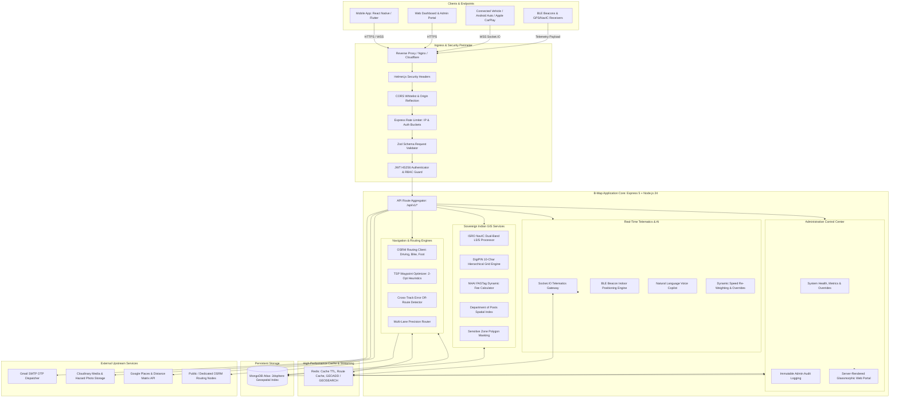
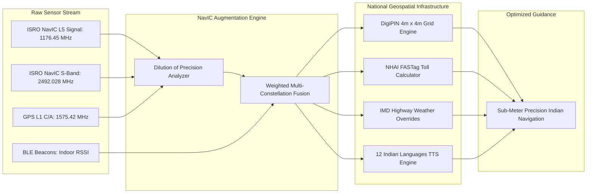
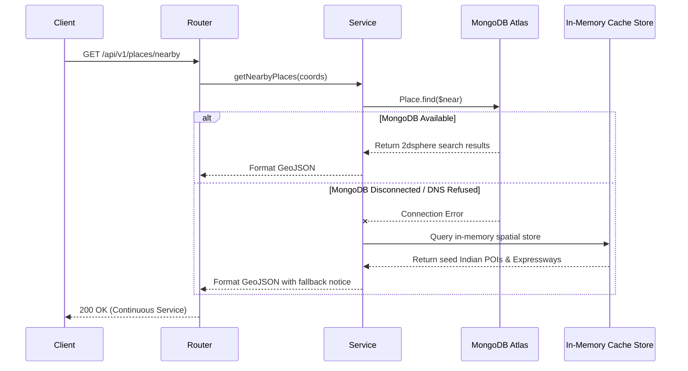
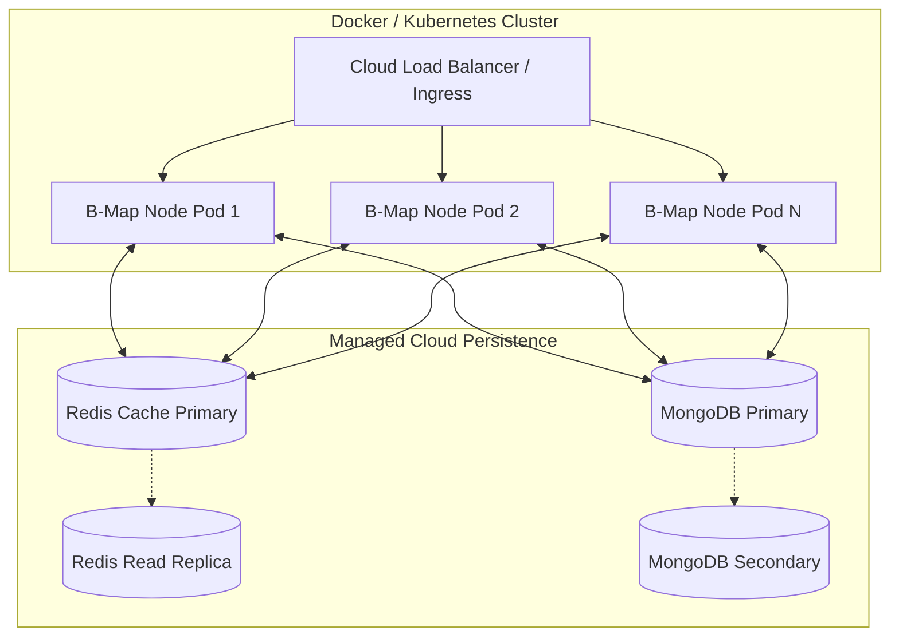

# 🏛️ B-Map Platform Architecture Specification

> **Sovereign Indian Geospatial, Turn-by-Turn Navigation & Real-Time Telematics Engine**  
> *Version:* 1.2.0 | *Runtime:* Node.js 24 + TypeScript | *Revision:* Production-Ready

---

## 1. Architectural Philosophy & Overview

**B-Map** is an enterprise-scale geospatial, routing, and real-time navigation platform designed specifically for the Indian subcontinental geography while retaining global compatibility. The platform is architected around the following foundational principles:

1. **Decoupled Modularity**: Over 40 discrete domain modules operate independently behind a unified Express router, enabling clean domain boundary separation.
2. **Sub-Millisecond Geospatial Caching**: High-frequency spatial queries (routes, driver tracking, nearby points of interest) leverage Redis in-memory caches, `GEOADD`, and `GEOSEARCH` primitives before querying persistent storage.
3. **Sovereign Indian Navigation Stack**: Native first-class integration with ISRO NavIC (IRNSS) dual-frequency L5/S-band satellite positioning, DigiPIN 4m×4m hierarchical addressing, Postal Pincodes, FASTag Toll pricing, and IMD Highway Weather advisories.
4. **Dual-Tier Offline Resilience**: Critical endpoints operate seamlessly even during database or network partition states via intelligent in-memory fallback stores and mock caches.
5. **Bidirectional Low-Latency Telematics**: Socket.IO-driven real-time positioning, driver breadcrumbs, Head-Up Display (HUD) progress streaming, and instant off-route reroute notifications.

---

## 2. High-Level System Architecture Diagram



---

## 3. Layered Architectural Breakdown

### 3.1 Client Tier
The client tier consists of heterogeneous mobile, web, automotive, and IoT consumers:
- **Mobile Native Applications**: Built with React Native or Flutter, communicating via JSON REST endpoints for bootstrap data and persistent WebSocket channels for turn-by-turn guidance.
- **In-Vehicle Infotainment (IVI)**: Android Automotive OS, Apple CarPlay, and connected dashboard displays consuming Lane-Level routing, Speed-Camera alerts, and V2X notifications.
- **Admin Control Web Center**: Built as a responsive, server-rendered glassmorphic single-page experience served directly from `/admin/dashboard`.
- **Bluetooth Low Energy (BLE) Nodes**: Hardware beacons positioned in multistory parking facilities, metro stations, and shopping malls transmitting UUID, Major, and Minor broadcast packets.

### 3.2 Ingress & Security Perimeter Tier
All inbound HTTP and WebSocket requests pass through strict defence-in-depth security layers:
- **Reverse Proxy / SSL Termination**: Enforces TLS 1.3 encryption, gzip/brotli compression, and IP forwarding headers (`X-Forwarded-For`).
- **HTTP Header Hardening (`helmet`)**: Strips `X-Powered-By`, injects `Content-Security-Policy`, `Strict-Transport-Security` (HSTS), `X-Frame-Options: SAMEORIGIN`, and `X-Content-Type-Options: nosniff`.
- **CORS Hardening**: Dynamically reflects trusted origins when `credentials: true` is asserted, adhering to RFC and W3C specifications without illegal wildcard collisions.
- **Dual-Tier Rate Limiting (`express-rate-limit`)**:
  - `authRateLimiter`: Restricts `/api/v1/auth/*` to **15 attempts per 15 minutes** per IP to eliminate credential-stuffing and SMTP exhaustion attacks.
  - `apiRateLimiter`: Restricts general API queries to **300 requests per minute** per client.
- **Input Sanitization & Schema Validation (`zod`)**: Validates `req.body`, `req.query`, and `req.params` against strict types before execution reaches controller handlers.

### 3.3 Application Core & Domain Tier
The backend adopts a modular domain architecture where each capability is isolated in `src/modules/<domain>/`:

```
src/modules/
├── admin/               # Web dashboard, dynamic config, audit logs, traffic/weather overrides
├── ai-copilot/          # Natural Language Voice Navigation & LLM Copilot
├── ai-data-mining/      # Spatial pattern mining, congestion prediction, trip profiling
├── ar-walk-cycle/       # Augmented Reality walking and micromobility guidance
├── auth/                # Email OTP signup, passwordless login, JWT HS256 tokens
├── automotive/          # Automotive HUD telemetry, ADAS, collision prevention
├── boundaries/          # GeoJSON boundaries (states, districts, municipal wards)
├── car-navigation/      # Multi-alternative vehicle routes, lane guidance
├── digipin/             # ISRO/DoP 4m x 4m hierarchical alphanumeric digital address grid
├── emergency/           # Emergency SOS distress dispatch, nearest ambulance/police routing
├── environment/         # Air Quality Index (AQI), green eco-routes, low-emission zones
├── evcharging/          # EV charging stations, connector availability, range planning
├── fares/               # Auto-rickshaw, taxi, and metro fare estimation matrices
├── fleet/               # Multi-vehicle fleet telematics, geofence monitoring
├── hazards/             # Community & official road hazards (potholes, accidents, floods)
├── health/              # System uptime, memory metrics, MongoDB/Redis connectivity checks
├── lane-routing/        # High-definition lane-level maneuvers & highway lane assist
├── location-access/     # GPS telemetry ingestion, batch location uploading
├── maps-tiles/          # Vector and raster map tile proxying and rendering
├── motion-fitness/      # Accelerometer activity detection (driving, walking, cycling)
├── navic/               # ISRO NavIC L5/S-band constellation processing & augmentation
├── navigation/          # Active navigation session engine, cross-track error, rerouting
├── nearby-devices/      # Bluetooth BLE beacon indoor trilateration & mapping
├── notifications/       # Push notifications, geofence boundary alerts
├── parking/             # Multilevel indoor parking guidance & slot availability
├── pincode/             # Indian 6-digit postal code spatial search & geocoding
├── places/              # Points of Interest (POIs), categories, MongoDB $near geospatial queries
├── positioning/         # Multi-sensor positioning, dead reckoning, sensor fusion
├── public-transit/      # Delhi Metro, BMTC, BEST bus timetables & multimodal routing
├── ratings/             # Place reviews, road quality crowdsourced ratings
├── rider-mode/          # Two-wheeler specific navigation (narrow lanes, flyover restrictions)
├── roads/               # National Highway (NH), Expressways, state road metadata
├── routes/              # OSRM route directions, TSP trip optimization, map matching
├── spatial-visualization/# 3D terrain meshes, building footprints, traffic heatmaps
├── sr-navigation/       # Spatial Reality mixed-reality navigation HUD
├── super-app/           # Super-app unified commerce, fuel stations, roadside dining
├── timezone/            # Indian Standard Time (IST) geospatial timezone mapping
├── tolls/               # NHAI FASTag electronic toll plazas, rates, cashless lanes
├── tracking/            # Real-time driver location tracking, Redis GEO proximity
├── unified-engine/      # Orchestrated multimodal route synthesis
├── v2x/                 # Vehicle-to-Everything (V2X) hazard & signal broadcasting
├── vernacular/          # 12 Indian regional language voice direction translation
└── weather/             # IMD highway weather advisories, monsoon flooding, winter fog
```

### 3.4 Storage, Caching & Real-Time Tier
- **MongoDB Cluster**: Primary document store utilizing `2dsphere` geospatial indices on `[longitude, latitude]` coordinate pairs for high-performance `$near`, `$geoWithin`, and `$geoIntersects` queries.
- **Redis In-Memory Engine**:
  - **Route Cache**: Hashes origin/destination/waypoints into deterministic keys with an expiring TTL (default: 3600s).
  - **Spatial Geo Tracking**: Leverages `GEOADD` and `GEOSEARCH` primitives for sub-millisecond proximity detection of active drivers.
  - **OTP Temporary Store**: Holds 6-digit verification codes with an automatic 300s TTL.
- **Socket.IO Real-Time Gateway**:
  - WebSocket rooms keyed by session ID (`nav:<sessionId>`) and driver ID (`driver:<driverId>`).
  - Broadcasts location updates at 1Hz–5Hz frequencies.
  - Pushes instantaneous off-route reroute geometry directly to mobile HUDs.

---

## 4. Sovereign Indian Navigation Stack



### Key Sovereign Integrations:
1. **ISRO NavIC Dual-Frequency Processing**: Ingests L5 and S-band carrier frequencies to bypass ionospheric delay errors common in tropical equatorial regions.
2. **DigiPIN Hierarchical Grid**: Transforms any latitude/longitude across India into a 10-character alphanumeric digital address accurate to a 4m×4m cell.
3. **National FASTag Toll Database**: Computes real-time toll charges for National Expressways (e.g., Delhi-Mumbai NE-4, Yamuna Expressway, NH-48) with vehicle-class pricing.
4. **IMD Severe Weather Integration**: Broadcasts automated reroutes during heavy monsoon flooding or zero-visibility northern winter fog.
5. **Vernacular Multi-Lingual Directions**: Voice-ready directional strings translated across 12 Indian languages: Hindi, Tamil, Telugu, Bengali, Marathi, Gujarati, Kannada, Malayalam, Punjabi, Odia, Assamese, and English.

---

## 5. Offline-First Resilience & In-Memory Fallback

To ensure non-stop navigation during connectivity blackouts or database maintenance, the system implements an active fallback pattern:



---

## 6. Security & Compliance Architecture

| Security Domain | Implementation | Security Standard |
| :--- | :--- | :--- |
| **Authentication** | Passwordless 6-digit OTP dispatched via TLS SMTP | NIST SP 800-63B |
| **Session Integrity**| JWT signed with HS256, verified with pinned algorithm | RFC 7519 / OWASP A02 |
| **Transport** | TLS 1.3, Strict-Transport-Security (1 year, includeSubDomains) | OWASP A05 |
| **API Rate Limiting**| Dual sliding-window token bucket (Auth: 15/15m, General: 300/1m)| OWASP A04 (Anti-Automation) |
| **ReDoS Defense** | All dynamic RegExp expressions escaped via `escapeRegExp()` | CWE-1333 / CWE-400 |
| **XSS Defense** | Entity encoding (`escapeHtml()`) on all dynamic UI templates | CWE-79 / OWASP A03 |
| **Credential Safety**| Zero default secrets in code; runtime validation via Zod | CWE-798 |
| **Defense Obfuscation**| Sensitive military & national security polygon masking | National Geospatial Policy |

---

## 7. Deployment & Scalability Topology


- **Horizontal Scaling**: Stateless Express containers can scale horizontally across Kubernetes pods.
- **WebSocket Sticky Sessions**: When scaled behind multiple pods, Socket.IO uses Redis adapter (`@socket.io/redis-adapter`) for cross-node event broadcasting.
- **Health Probing**: Kubernetes `livenessProbe` and `readinessProbe` target `/api/v1/health` with sub-50ms latency checks.
