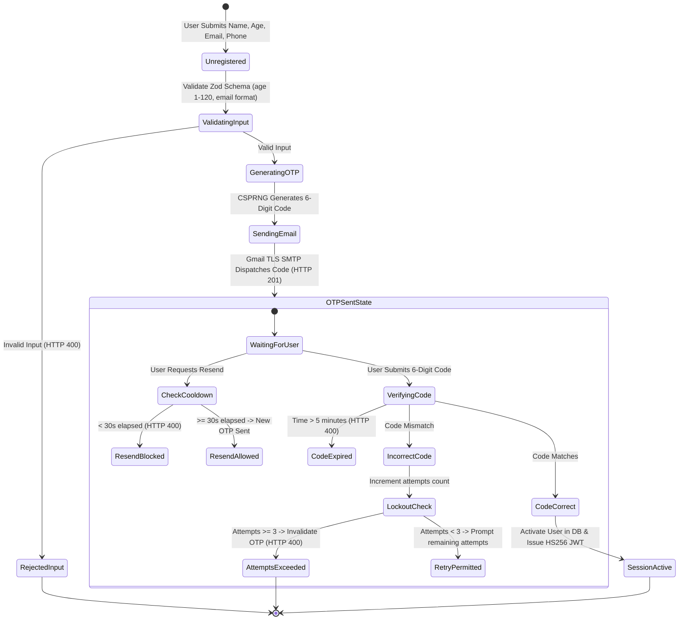
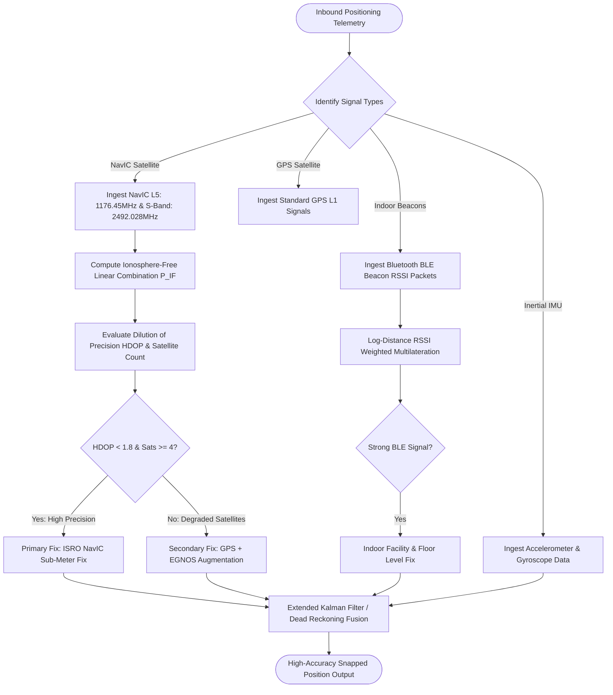
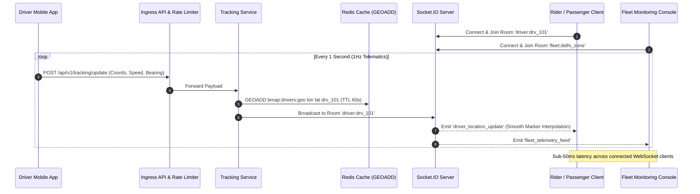
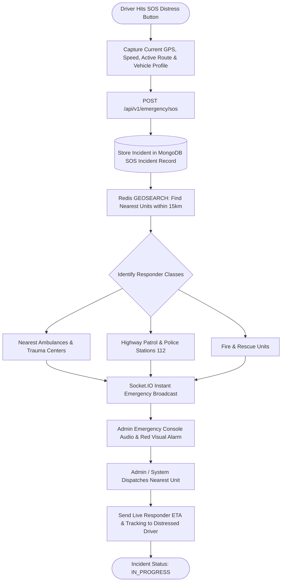
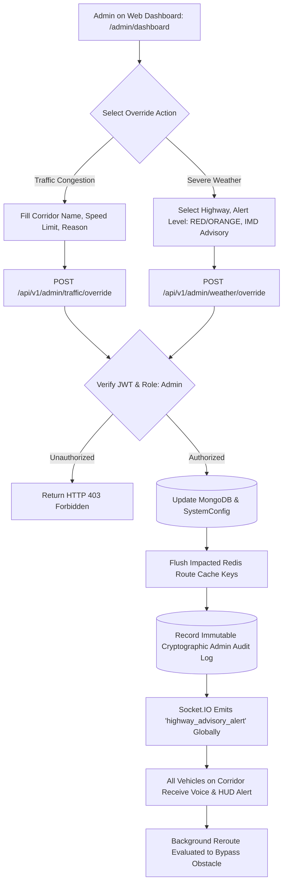

# 🔄 B-Map Platform Complete System Flowcharts

> **Visual Architectural Workflows, State Machines & Event Sequence Diagrams**  
> *Target System:* B-Map Navigation Backend | *Diagrams:* Interactive Mermaid Graphs

---

## 1. End-to-End Turn-by-Turn Navigation & Dynamic Rerouting Flow

This diagram illustrates the lifecycle of a driver from initial route computation through active tracking, off-route cross-track error detection, and automatic reroute push.


---

## 2. Passwordless User Registration & Email OTP State Machine

This state machine details how users register with their Name, Age, Email, and Phone Number, and how the OTP verification prevents replay and brute-force attacks.



---

## 3. NavIC / Multi-Sensor Positioning & Fallback Hierarchy

This diagram maps how raw satellite and telematics signals are synthesized through ISRO NavIC dual-frequency corrections and local sensor fusion.



---

## 4. Real-Time Telematics & Socket.IO Room Broadcast Architecture

This diagram shows how high-frequency driver locations are ingested into Redis and broadcast to passenger and fleet monitoring clients.



---

## 5. DigiPIN 4m × 4m National Hierarchical Grid Encoding Flow

This diagram shows how any geographic coordinate in India is resolved into an official 10-character alphanumeric digital address.

```mermaid
flowchart TD
    StartCoords([Input Latitude & Longitude]) --> CheckBounds{Within India Bounding Box? Lat: 6-38N, Lon: 68-100E}

    CheckBounds -->|No| OutOfBounds[Return Bounding Box Error]
    CheckBounds -->|Yes| Normalize[Normalize to Unit Matrix [0, 1]]

    Normalize --> InitGrid[Initialize Tier = 1, Output = '']

    InitGrid --> LoopTier{Tier <= 10?}

    LoopTier -->|Yes| Subdivide[Subdivide Active Cell into 32 Sub-Quadrants]
    Subdivide --> MapIndices[Map Relative Coordinates to Row r & Column c]
    MapIndices --> LookupAlphabet[Character = DigiPIN_Alphabet 2-9, A-Z excl. 0,1,O,I]
    LookupAlphabet --> AppendChar[Output += Character]
    AppendChar --> RefineBox[Contract Bounding Box to Selected Cell]
    RefineBox --> IncrementTier[Tier = Tier + 1]
    IncrementTier --> LoopTier

    LoopTier -->|No: Tier = 10 reached| FinalDigiPIN[Format 10-Character String: e.g. 28J4-K8M2-9P]
    FinalDigiPIN --> ReturnResult([Return 4m x 4m Precise Cell & Centroid])
```

---

## 6. Emergency SOS Distress Trigger & Proximity Dispatch Flow

This flowchart illustrates the critical life-safety flow when a motorist or pedestrian triggers an emergency SOS alert.



---

## 7. Administrative Traffic & Weather Override Broadcast Pipeline

This diagram shows how administrators inject manual hazard advisories or severe weather warnings that instantly update navigation routes.



---

## 8. High-Availability Storage & In-Memory Offline Fallback Flow

This flowchart illustrates the fault-tolerant in-memory fallback pattern that protects the platform against database outages and DNS resolution errors.


