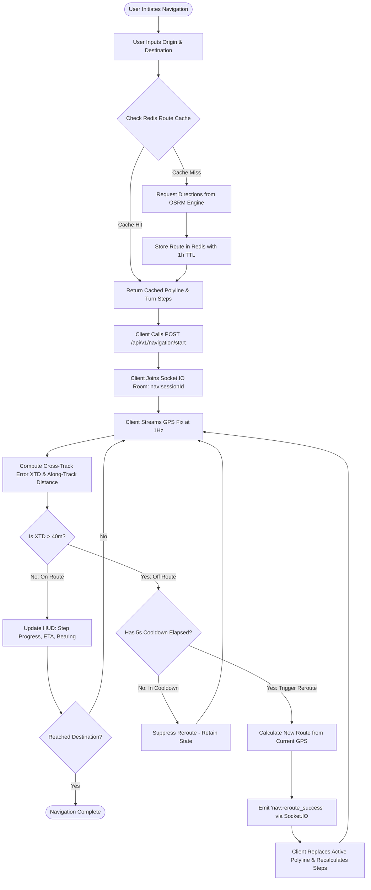
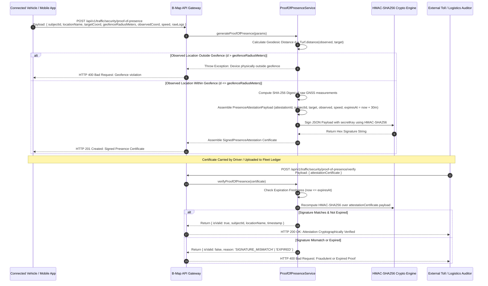
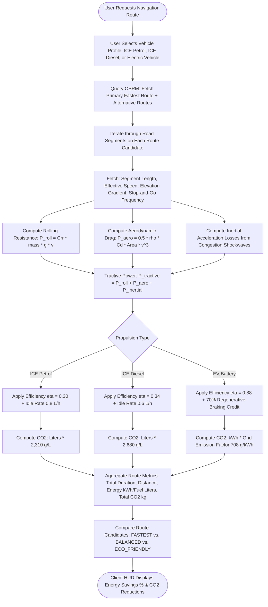
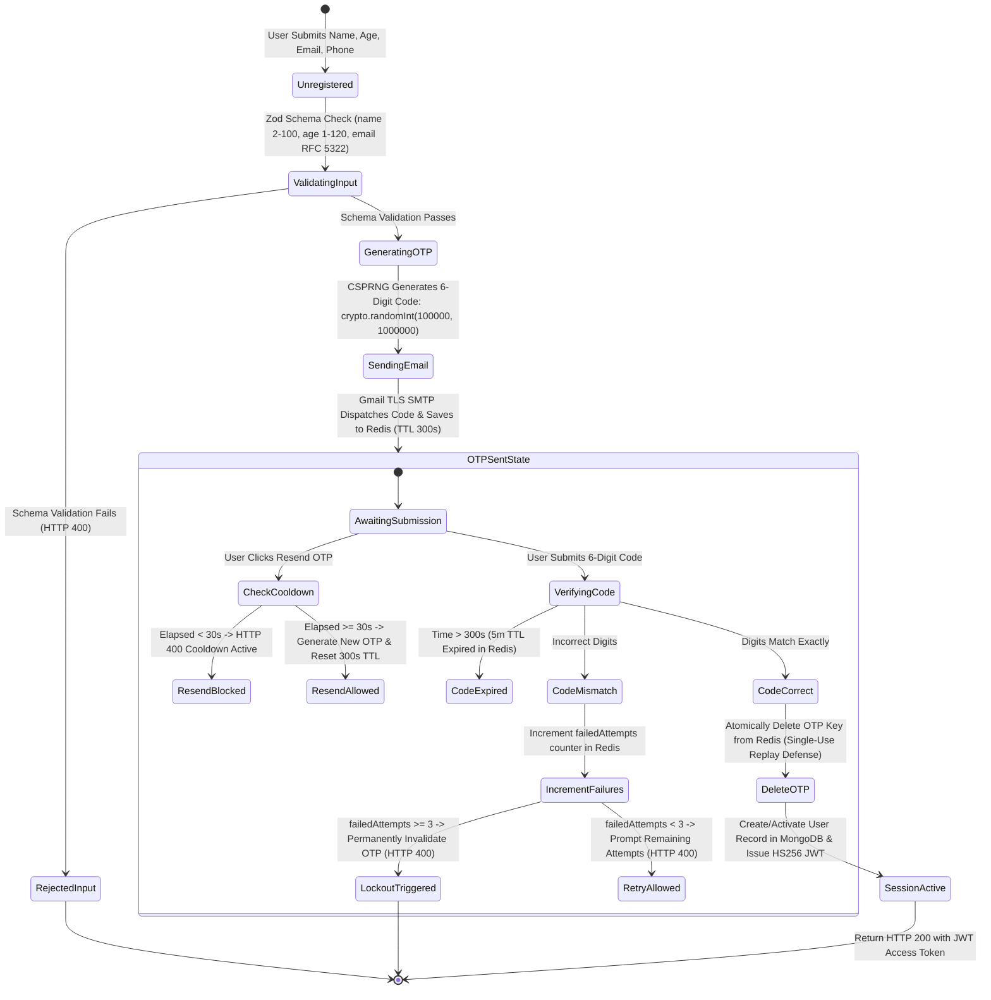
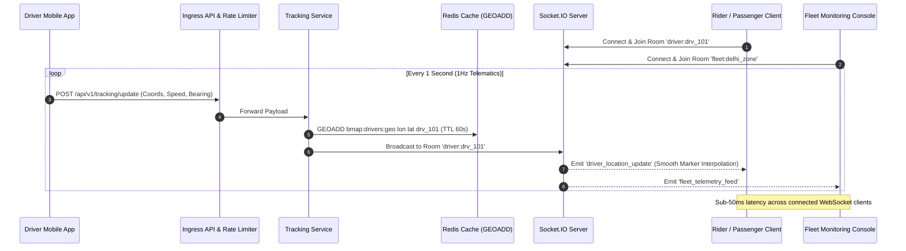
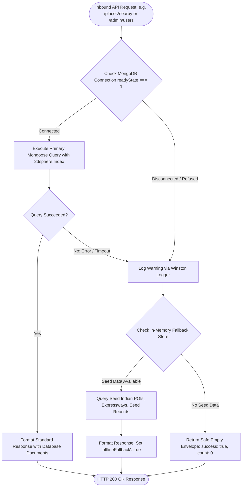

# 🔄 B-Map Platform Complete System Flowcharts

> **Visual Architectural Workflows, State Machines & Event Sequence Diagrams**  
> *Target System:* B-Map Navigation & Telematics Backend | *Version:* 2.0.0 | *Diagrams:* Interactive Mermaid Graphs

---

## 1. End-to-End Turn-by-Turn Navigation & Dynamic Rerouting Flow

This diagram illustrates the lifecycle of a driver from initial route computation through active tracking, off-route cross-track error detection, and automatic reroute push.



---

## 2. Real-Time Telematics Ingestion, Anti-Spoofing, EKF & Traffic Re-Weighting Flowchart

This flowchart details the complete lifecycle of a velocity vector from raw vehicle transmission through cryptographic verification, kinematic physics checks, 6-state Kalman filtering, spatial road segment snapping, DBSCAN tea-stall outlier rejection, BPR dynamic edge weight updates (in travel time minutes), and real-time Socket.IO broadcasting.

```mermaid
flowchart TD
    Start([Vehicle / Mobile Streams Telemetry]) --> CapturePayload[Capture: lon, lat, speedKmh, headingDeg, accuracy, timestamp]
    CapturePayload --> AddHeaders[Inject Headers: X-BMap-Signature, X-BMap-Timestamp, X-BMap-Nonce]
    AddHeaders --> Transmit[POST /api/v1/traffic/telemetry or Socket.IO 'traffic:telemetry_stream']

    Transmit --> Ingress[Ingress Security Gateway & Anti-Recon Trap]
    Ingress --> RateLimit{Rate Limit Check: apiRateLimiter 300/1m}
    RateLimit -->|Exceeded| Drop429[Return HTTP 429 Too Many Requests]
    RateLimit -->|Pass| VerifySigner{TelemetrySignerGuard: Verify HMAC-SHA256}

    VerifySigner -->|Bad Signature| Drop401[Return HTTP 401 Unauthorized]
    VerifySigner -->|Freshness dt > 45s| DropExpired[Return HTTP 401 Stale Timestamp Error]
    VerifySigner -->|Nonce Seen| DropReplay[Return HTTP 403 Nonce Replay Detected]
    VerifySigner -->|Valid Signature & Fresh| AntiSpoofCheck{AntiSpoofingGuard: Verify Kinematics}

    AntiSpoofCheck -->|Accel > 6.5 m/s²| RejectSpoof[Reject: IMPOSSIBLE_ACCELERATION]
    AntiSpoofCheck -->|Speed > 220 km/h| RejectSpoof[Reject: TELEPORTATION_ANOMALY]
    AntiSpoofCheck -->|Bearing Δ > 70°| RejectSpoof[Reject: BEARING_DISPLACEMENT_MISMATCH]
    AntiSpoofCheck -->|Entropy < 1e-9| RejectSpoof[Reject: SYNTHETIC_ZERO_JITTER]
    AntiSpoofCheck -->|Mock Provider True| RejectSpoof[Reject: MOCK_LOCATION_FLAG]

    AntiSpoofCheck -->|Kinematics Verified| EKFUpdate[6-State Extended Kalman Filter CWNA Model]
    EKFUpdate --> CovarianceGate{Covariance Trace Tr-P OK?}
    CovarianceGate -->|High Uncertainty| ExtrapolateDR[Extrapolate Dead Reckoning max 10s]
    CovarianceGate -->|Nominal Fix| SmoothState[State Corrected: Smoothed [lon, lat], Speed, Heading]

    ExtrapolateDR --> SpatialSnap
    SmoothState --> SpatialSnap[Spatial Road Snapping: Map Vector to Nearest RoadSegmentEdge]

    SpatialSnap --> CheckSpeed{Is Device Speed < 15 km/h?}
    CheckSpeed -->|No: Moving Normally| IngestNormal[Ingest into Segment Speed Sample Buffer]
    CheckSpeed -->|Yes: Slow / Stopped| DBSCANCluster[Execute DBSCAN Spatial Clustering: eps=45m, minPts=3]

    DBSCANCluster --> EvalCluster{Is Device Part of Cluster >= 3 Devices?}
    EvalCluster -->|No: Isolated Device| RejectAnomaly[Reject False Positive: Roadside Tea Stall / Chai Shop Stop]
    RejectAnomaly --> SocketAnomalyNotify[Emit Socket.IO 'traffic:anomaly_filtered']
    EvalCluster -->|Yes: Clustered Congestion| IngestCongestion[Validate Congestion: Ingest into Segment Buffer]

    IngestNormal --> RecalcBPR
    IngestCongestion --> RecalcBPR[BPR Formulation: Recalculate Edge Travel Time in MINUTES]

    RecalcBPR --> UpdateGraph[Update Directed Road Graph: Set edge.weightMinutes & effectiveSpeedKmh]
    UpdateGraph --> RedisCache[Update Redis Key: bmap:traffic:segments]
    UpdateGraph --> SocketBroadcast[Socket.IO Broadcasts 'traffic:segment_update' to Connected Clients]
    SocketBroadcast --> EndFlow([Real-Time Congestion Reflected on Navigation HUDs])
```

---

## 3. Macroscopic LWR Traffic Shockwave Dynamics & Upstream Spillback Flowchart

This flowchart illustrates how the Lighthill-Whitham-Richards (LWR) fluid dynamics engine analyzes queue accumulation, computes shockwave boundary speeds, and emits preemptive upstream spillback alerts before traffic reaches a standstill.

```mermaid
flowchart TD
    Trigger([Segment Speed Drop Detected on Edge E_target]) --> ReadAttributes[Fetch: Free Flow Speed v_free, Current Speed v_curr, LanesCount]
    ReadAttributes --> FetchUpstream[Identify Upstream Inflow Edge E_upstream]

    FetchUpstream --> CalcDensities[Compute Densities via Greenshields Model]
    CalcDensities --> JamDensity[k_jam = 135 veh/km * lanes]
    JamDensity --> CurrentDensity[k_2 = k_jam * 1 - v_curr / v_free]
    JamDensity --> UpstreamDensity[k_1 = k_jam * 1 - v_upstream / v_free]

    CurrentDensity --> CalcFlowRates[Calculate Flow Rates: q = k * v]
    CalcFlowRates --> Capacity[q_capacity = v_free * k_jam / 4]
    Capacity --> FlowRates[Compute q_1 Upstream Arrival vs q_2 Bottleneck Discharge]

    FlowRates --> ShockwaveVelocity[Compute Shockwave Velocity: w = q_2 - q_1 / k_2 - k_1]

    ShockwaveVelocity --> ClassifyWave{Evaluate Shockwave Speed w}
    ClassifyWave -->|w < -5.0 km/h| BackWave[Direction: BACKWARD_FORMING Queue Growing Upstream]
    ClassifyWave -->|w > +5.0 km/h| ForeWave[Direction: FORWARD_RECOVERY Queue Dissipating]
    ClassifyWave -->|-5.0 <= w <= +5.0| StatWave[Direction: STATIONARY Bottleneck]

    BackWave --> CalcQueueLength[Compute Queue Length L_queue = k_2 * segmentLength]
    CalcQueueLength --> CalcSpillbackTime[Calculate Spillback Time: t_spillback = D_upstream / |w| * 60 minutes]

    CalcSpillbackTime --> CheckSpillbackRisk{Is t_spillback <= 5.0 Minutes?}
    CheckSpillbackRisk -->|No: Queue Far Off| LogShockwave[Log Shockwave Telematics Record]
    CheckSpillbackRisk -->|Yes: Urgent Spillback Risk| TriggerSpillbackAlarm[Generate TRAFFIC_CONGESTION_ALERT]

    TriggerSpillbackAlarm --> SocketSpillbackPush[Emit Socket.IO 'traffic:congestion_alert' to Upstream Vehicles]
    SocketSpillbackPush --> PreemptiveReroute[Active Navigation Sessions Trigger Preemptive Reroute]
    PreemptiveReroute --> DivertTraffic([Traffic Diverted to Parallel Arterial Corridors])
```

---

## 4. Cryptographic Spatial Proof-of-Presence Attestation Flowchart

This flowchart outlines the generation and third-party verification of tamper-evident spatial Proof-of-Presence certificates used for electronic highway tolling, logistics delivery verification, and usage-based insurance telematics.



---

## 5. Multi-Criteria Physics-Based Eco-Routing Decision Flowchart

This flowchart shows how B-Map computes energy consumption based on aerodynamic drag, rolling resistance, inertial stop-and-go penalties, and vehicle powertrain mechanics to synthesize eco-friendly navigation routes.



---

## 6. Passwordless User Registration & Email OTP State Machine

This state machine illustrates how B-Map securely registers and authenticates users via cryptographic 6-digit email OTPs, enforcing resend cooldowns, brute-force lockouts, and algorithm-pinned JWT issuance.



---

## 7. NavIC / Multi-Sensor Positioning & Sovereign GIS Resolution Flowchart

This flowchart demonstrates the ingestion of satellite and national GIS data, from ISRO NavIC dual-frequency ionospheric cancellation through 4m×4m DigiPIN resolution, NHAI FASTag electronic toll estimation, IMD highway weather integration, and 12-language vernacular voice translation.

```mermaid
flowchart TD
    Sensors([Multi-Constellation Satellite & Hardware Telemetry]) --> SplitCarrier{Identify Carrier Frequencies}

    SplitCarrier -->|NavIC L5: 1176.45 MHz| IngestL5[Ingest NavIC L5 Carrier Signal]
    SplitCarrier -->|NavIC S-Band: 2492.028 MHz| IngestS[Ingest NavIC S-Band Carrier Signal]
    SplitCarrier -->|GPS L1 C/A: 1575.42 MHz| IngestGPS[Ingest Standard Civilian GPS L1]
    SplitCarrier -->|BLE Beacons| IngestBLE[Ingest Indoor RSSI Signal Packets]

    IngestL5 --> IonoCancel[Compute Dual-Frequency Ionosphere-Free Linear Combination P_IF]
    IngestS --> IonoCancel

    IonoCancel --> EvaluateDOP[Analyze Dilution of Precision: HDOP, PDOP, GDOP]
    IngestGPS --> EvaluateDOP
    IngestBLE --> BLETrilaterate[Log-Distance Weighted RSSI Multilateration]

    EvaluateDOP --> CheckNavICConfidence{Is HDOP < 1.8 & NavIC Sats >= 4?}
    CheckNavICConfidence -->|Yes| PrimaryNavIC[Primary Sub-Meter Sovereign NavIC Fix]
    CheckNavICConfidence -->|No| SecondaryGPS[Secondary GPS + GAGAN Augmentation Fix]

    PrimaryNavIC --> Fusion[Extended Kalman Filter Multi-Sensor Fusion]
    SecondaryGPS --> Fusion
    BLETrilaterate --> Fusion

    Fusion --> SovereignGISDispatch[High-Precision Coordinate Output [lon, lat]]

    SovereignGISDispatch --> DigiPINEngine[DigiPIN Engine: 10-Char Hierarchical Grid Subdivision]
    DigiPINEngine --> DigiPINCode[Generate 4m x 4m National Address Code: e.g. 28J4-K8M2-9P]

    SovereignGISDispatch --> FASTagEngine[FASTag Engine: Match Route with NHAI Toll Plazas]
    FASTagEngine --> TollCalculation[Calculate Toll Rates across Vehicle Classes 4 to 9]

    SovereignGISDispatch --> IMDWeatherEngine[IMD Weather Engine: Query Highway Fog & Flood Advisories]
    IMDWeatherEngine --> WeatherAlerts[Generate Weather Warnings: GREEN, YELLOW, ORANGE, RED]

    SovereignGISDispatch --> DefenseEngine[Defense Obfuscation: Check Restricted Military Boundaries]
    DefenseEngine --> ObfuscateCoords[Apply 200m-500m Jitter to Sensitive Installations]

    SovereignGISDispatch --> VernacularEngine[Vernacular TTS Engine: Select User Language]
    VernacularEngine --> TranslateVoice[Translate Maneuvers across 12 Indian Languages: hi, ta, te, bn, mr, gu, kn, ml, pa, or, as, en]

    DigiPINCode --> NavigationCockpit([Unified Sovereign Indian Navigation Cockpit])
    TollCalculation --> NavigationCockpit
    WeatherAlerts --> NavigationCockpit
    ObfuscateCoords --> NavigationCockpit
    TranslateVoice --> NavigationCockpit
```

---

## 8. Real-Time Telematics & Socket.IO Room Broadcast Architecture

This diagram shows how high-frequency driver locations are ingested into Redis and broadcast to passenger and fleet monitoring clients.



---

## 9. Emergency SOS Distress Trigger & Proximity Dispatch Flow

This flowchart illustrates the critical life-safety flow when a motorist or pedestrian triggers an emergency SOS alert.


---

## 10. High-Availability Storage & In-Memory Offline Fallback Flow

This flowchart illustrates the fault-tolerant in-memory fallback pattern that protects the platform against database outages and DNS resolution errors.


